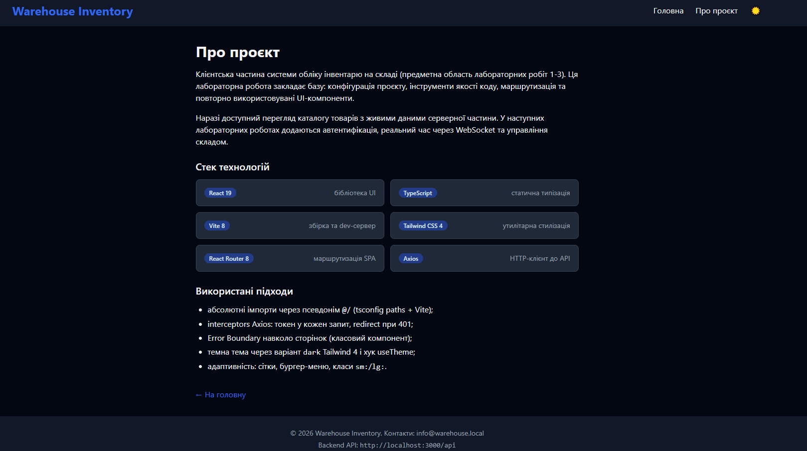
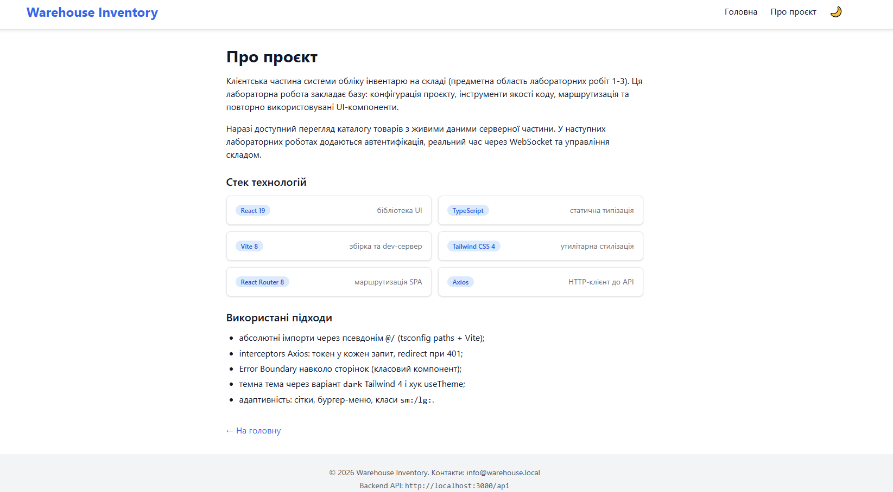
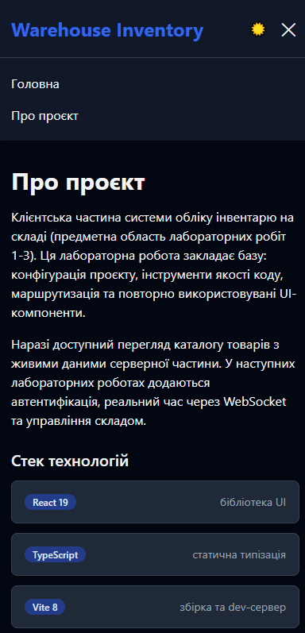

# Warehouse Inventory — клієнтська частина

## Опис проєкту

Клієнтська частина системи обліку інвентарю на складі (предметна область лабораторних
робіт 1-3, серверна частина в корені цього репозиторію). Лабораторна робота 4 закладає
базу клієнта: конфігурація проєкту (Vite + TypeScript), інструменти якості коду,
маршрутизація, повторно використовувані UI-компоненти, темна тема та інтеграція з API.

Наразі реалізовано: перегляд каталогу товарів з живими даними серверної частини,
адаптивна навігація з бургер-меню, темна тема з запам'ятовуванням вибору, сторінки
Home / About / NotFound, Error Boundary та обробка станів завантаження й помилок.

## Технології

- React 19
- TypeScript
- Vite 8
- Tailwind CSS 4 (директиви `@theme` та `@custom-variant dark`, без tailwind.config.js)
- React Router 8 (пакет `react-router`)
- Axios (з interceptors)
- ESLint 10 (flat config) + Prettier

## Встановлення та запуск

### Вимоги

- Node.js 24 LTS
- npm

### Інструкції

```bash
# Клонування репозиторію (клієнт - у теці client/)
git clone https://github.com/Vovchik148/Web.git
cd Web/client

# Встановлення залежностей
npm install

# Копіювання .env файлу
cp .env.example .env

# Запуск серверної частини (в іншому терміналі, з кореня репозиторію)
docker compose up -d        # PostgreSQL + Redis
npm install && npx prisma generate && npx prisma migrate deploy
npm run db:seed             # тестові дані та користувачі

# Запуск у режимі розробки
npm run dev                 # http://localhost:5173

# Збірка для продакшену
npm run build

# Якість коду
npm run lint
npm run format
```

## Структура проєкту

```
client/src/
├── components/
│   ├── common/     # UI-компоненти: Button, Input, Card, Badge, Loading, ErrorBoundary
│   └── layout/     # Header (навігація + перемикач теми), Footer, Layout
├── pages/          # HomePage (каталог), AboutPage, NotFoundPage
├── services/       # api.ts - конфігурація Axios та interceptors
├── types/          # Типи TypeScript для відповідей API (api.types.ts)
├── utils/          # Форматування даних (format.ts)
├── hooks/          # useTheme - темна тема
└── constants/      # APP_NAME, ROUTES, NAV_ITEMS
```

## Ключові рішення

- **Абсолютні імпорти** `@/...`: `paths` у `tsconfig.app.json` + `resolve: { tsconfigPaths: true }` у `vite.config.ts`
- **Axios interceptors**: request - додає `Bearer` токен з localStorage; response - при 401 з наявним токеном очищає його і редиректить на `/login` (сторінка входу - лабораторна робота 5)
- **Error Boundary** (класовий компонент) обгортає `<Outlet />` у Layout
- **Темна тема**: `@custom-variant dark` у CSS + клас `.dark` на `<html>`, хук `useTheme` зберігає вибір у localStorage
- **Адаптивність**: сітка `grid-cols-1 sm:grid-cols-2 lg:grid-cols-3`, бургер-меню на мобільних

## Змінні середовища

| Змінна | Призначення | За замовчуванням |
|---|---|---|
| `VITE_API_URL` | адреса серверної частини | `http://localhost:3000/api` |
| `VITE_APP_NAME` | назва застосунку в UI | `Warehouse Inventory` |

Файли: `.env` (локальний, у .gitignore), `.env.development`, `.env.production`,
`.env.example`. У змінні з префіксом `VITE_` **не можна** зберігати секрети - вони
потрапляють у клієнтський бандл.

## Скріншоти

Темна тема:


Світла тема:


Мобільна версія:

