# Звіт з лабораторної роботи №1

**Тема:** Розроблення backend архітектури та основного функціоналу  
**Предметна область:** Система обліку інвентарю на складі  
**Виконав:** Шипкін Денис  
**Репозиторій:** https://github.com/Vovchik148/Web.git

## 1. Мета роботи

Здобути практичні навички створення серверної частини вебдодатку на Node.js та Express.js, спроєктувати структуру БД у PostgreSQL та реалізувати базові операції з даними.

## 2. Предметна область

Система обліку інвентарю на складі дозволяє вести номенклатуру товарів, кілька складів, постачальників, поточні залишки та журнал руху товарів (надходження, відвантаження, коригування). Працівники мають різні ролі та права.

Відповідність вимогам до предметної області:

| Вимога | Реалізація |
|---|---|
| 4–5+ пов'язаних сутностей | 7: User, Category, Supplier, Warehouse, Product, Stock, StockMovement |
| Різні типи зв'язків | 1:N (Category→Product тощо) та M:N (Product↔Warehouse через Stock) |
| Ролі та дозволи | ADMIN, MANAGER, WORKER |
| Потенціал для real-time | сповіщення про низький залишок, живе оновлення залишків при операціях |
| Завантаження файлів | можливе додавання фото товару та накладних до `Product` |

## 3. Технології

Node.js, Express.js, PostgreSQL, Prisma ORM, JWT, bcryptjs, express-validator, helmet, cors, Docker (PostgreSQL).

## 4. Хід роботи

### 4.1 Ініціалізація проєкту та залежності

`npm init -y`, встановлення express, prisma, @prisma/client, bcryptjs, jsonwebtoken, cors, helmet, dotenv, express-validator, nodemon.  
Скріншот: 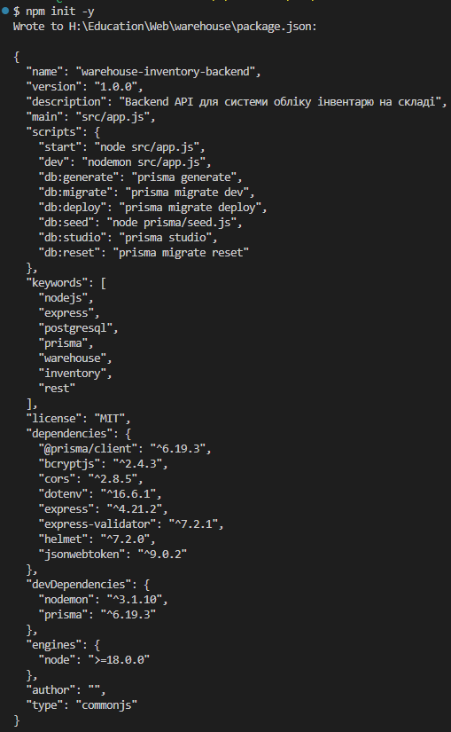

### 4.5 Змінні середовища
Файл `.env` (DATABASE_URL, JWT_SECRET, PORT, NODE_ENV); `.env` додано до `.gitignore`, у репозиторії лежить `.env.example`. Запуск застосунку без обов'язкових змінних завершується зрозумілою помилкою (`src/utils/config.js`).

### 4.6 Prisma-схема та міграція
Опис моделей і зв'язків — див. `prisma/schema.prisma` та ER-діаграму в `README.md`.  
Команда: `npx prisma migrate dev --name init`  
Скріншоти:

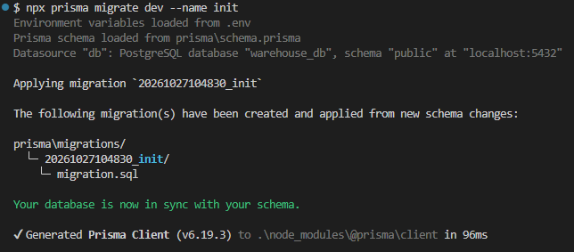, 
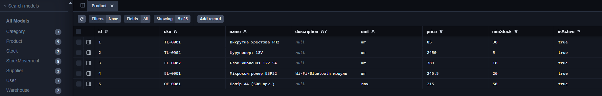

### 4.7 Express-сервер (`src/app.js`)
Підключені middleware: helmet, cors, express.json, маршрути `/api/*`, обробник 404, глобальний `errorHandler`.

### 4.8 Моделі (`src/models`)
Уся робота з БД через Prisma зосереджена в моделях. Для простих сутностей — фабрика `baseModel`, для товарів, користувачів та складських операцій — окремі моделі. Реєстрація руху товару виконується в транзакції (`prisma.$transaction`) з атомарним списанням, що виключає від'ємні залишки.

### 4.9 Контролери (`src/controllers`)
Контролери приймають запит, викликають модель і формують відповідь. Для приватності даних у відповідях немає хешів паролів; у модель потрапляють лише валідовані поля (`matchedData`).

### 4.10 Маршрути, валідація та права доступу (`src/routes`)
Для кожного ендпоінта описані правила `express-validator`, middleware автентифікації (`authenticate`) та ролей (`authorize`).

### 4.11 Тестування API
Тестування виконано у Postman / curl. Результати:

| № | Запит | Очікуваний результат |
|---|---|---|
| 1 | POST /api/auth/login | 200, токен |
| 2 | GET /api/products без токена | 401 |
| 3 | POST /api/products (WORKER) | 403 |
| 4 | POST /api/products (MANAGER, коректні дані) | 201 |
| 5 | POST /api/products (некоректні дані) | 400 + список помилок |
| 6 | GET /api/products?search=...&sortBy=price | 200, пагінація |
| 7 | PUT /api/products/:id | 200 |
| 8 | DELETE /api/products/:id (ADMIN) | 204 або 409 |
| 9 | POST /api/movements INBOUND | 201, залишок збільшився |
| 10 | POST /api/movements OUTBOUND більше за залишок | 409 |
| 11 | GET /api/stock/low | 200, товари з дефіцитом |

#### 1. Вхід користувача: POST /api/auth/login
Очікується `200` і JWT-токен у відповіді.

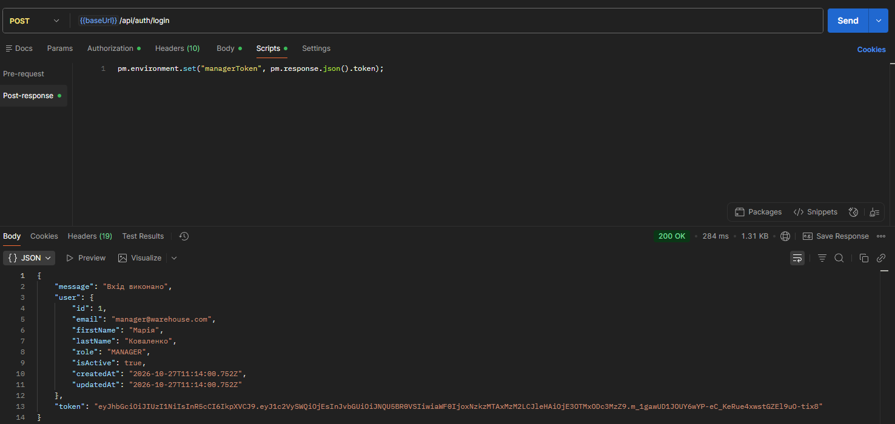

#### 2. Запит без токена: GET /api/products
Очікується `401`: доступ без авторизації заборонений.

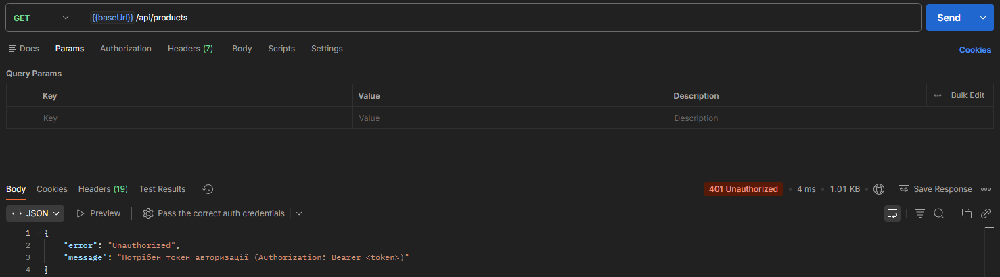

#### 3. Недостатньо прав: POST /api/products (WORKER)
Очікується `403`: комірник не може створювати товари.

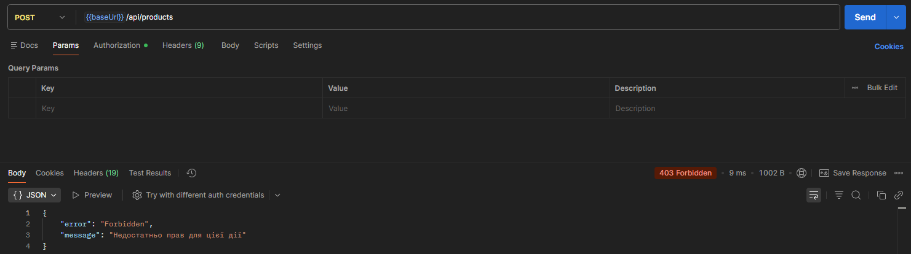

#### 4. Створення товару: POST /api/products (MANAGER)
Очікується `201` і створений товар із полем `totalQuantity`.

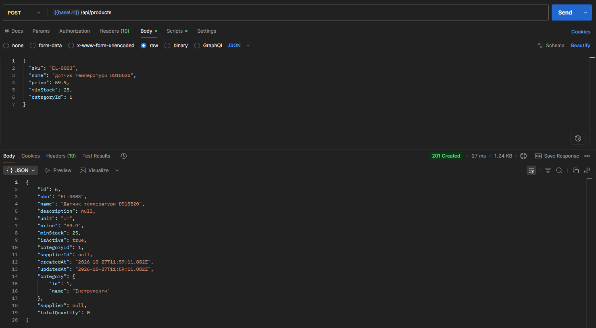

#### 5. Валідація: POST /api/products (некоректні дані)
Очікується `400` і список помилок по полях.

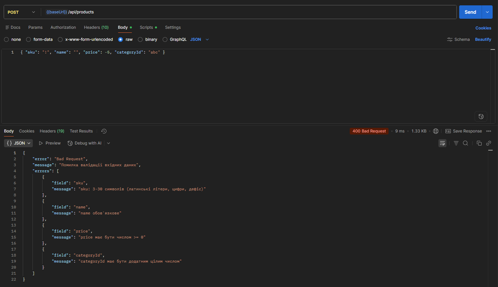

#### 6. Список товарів: GET /api/products?search=ESP&sortBy=price&order=asc
Очікується `200`, масив `data` та блок `pagination`.

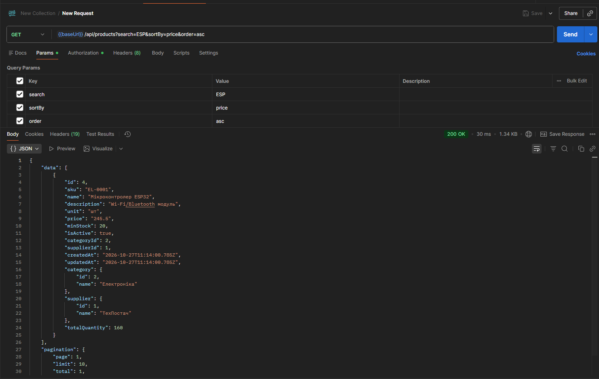

#### 7. Оновлення товару: PUT /api/products/:id
Очікується `200` і оновлені дані.

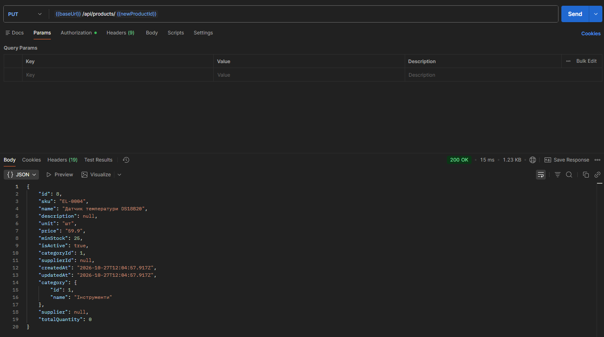

#### 8. Видалення товару: DELETE /api/products/:id (ADMIN)
Очікується `204`. Для товару з операціями в журналі: `409`.

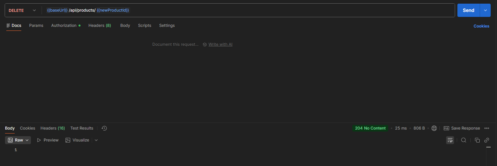
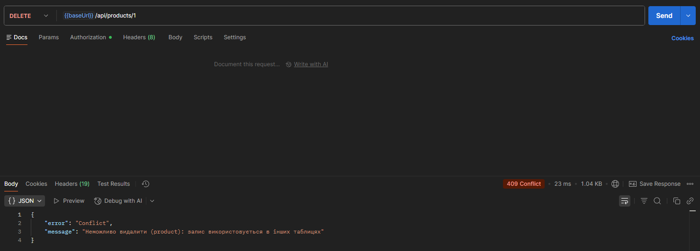

#### 9. Надходження: POST /api/movements (INBOUND)
Очікується `201`; залишок на складі збільшується.

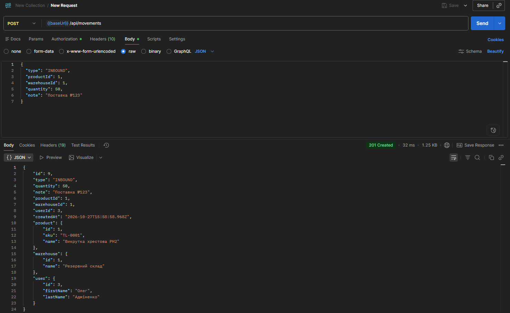

#### 10. Відвантаження більше за залишок: POST /api/movements (OUTBOUND)
Очікується `409`: недостатньо товару на складі.

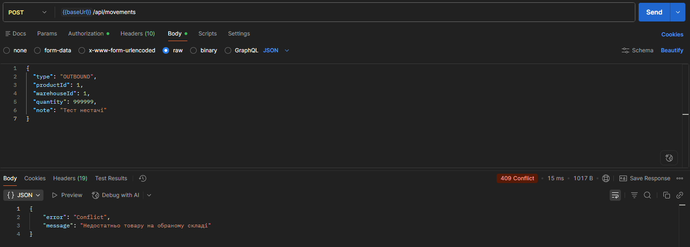

#### 11. Низькі залишки: GET /api/stock/low
Очікується `200` і список товарів із полем `deficit`.

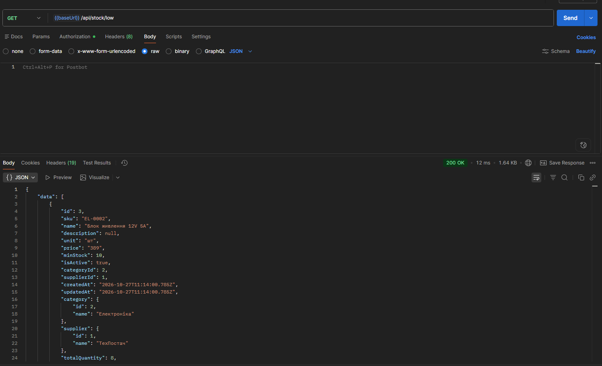

Документація API — файл `api_documantion.md`.

## 5. Висновки

