# Звіт з лабораторної роботи №2

**Тема:** Захист вебзастосунку: розширені механізми безпеки backend API  
**Предметна область:** Система обліку інвентарю на складі  
**Виконав:** Шипкін Денис  
**Репозиторій:** https://github.com/Vovchik148/Web.git

## 1. Мета роботи

Здобути практичні навички захисту серверної частини вебдодатку: обмеження кількості запитів, журналювання дій користувачів, детальних дозволів, відновлення пароля через email, двофакторної автентифікації (TOTP), входу через зовнішнього провайдера (OAuth 2.0) та розширення документації API.

## 2. Що додається до застосунку

Застосунок з попередньої лабораторної роботи (Express.js + PostgreSQL + Prisma, JWT-автентифікація, CRUD товарів, складський облік) розширено механізмами безпеки:

| № пункту методички | Механізм | Реалізація |
|---|---|---|
| 5 | Rate limiting | Загальний ліміт (100 зап./15 хв) та посилений для `/api/auth/*` (20 зап./15 хв, з `.env`), express-rate-limit |
| 7 | Завантаження кількох файлів | Другий екземпляр multer, `POST /api/files/upload-multiple` (до 10 файлів), відкат при помилці БД |
| 4 | Журналювання дій | Модель `AuditLog`, `src/utils/audit.js`, `GET /api/audit-logs` (лише ADMIN) |
| 6 | Детальні дозволи | `src/config/permissions.js` (мапа «роль → дозволи»), middleware `requirePermission()` |
| 1 | Відновлення пароля | Модель `PasswordResetToken` (у БД лише хеш), nodemailer + Ethereal, `forgot-password` / `reset-password` |
| 2 | Двофакторна автентифікація | otplib + qrcode (TOTP), маршрути `/2fa/setup`, `/2fa/enable`, `/2fa/disable`, `/2fa/verify` |
| 3 | OAuth | Вхід через GitHub (Authorization Code, без passport, лише fetch), модель `OAuthAccount` |
| 8 | Розширена документація | Схеми в `components` Swagger, приклади запитів/відповідей, усі коди помилок |

## 3. Технології

Node.js, Express.js 5, PostgreSQL, Prisma ORM, JWT, argon2, express-rate-limit, multer, nodemailer, otplib, qrcode, express-validator, Ethereal (тестова пошта), GitHub OAuth Apps, node:test + supertest.

## 4. Хід роботи

> Усі команди виконуються при запущеному сервері (`npm run dev`) та базі даних (`docker compose up -d`).
> Токен для авторизованих запитів зручно зберігати у змінну:
>
> ```bash
> TOKEN=<accessToken із відповіді POST /api/auth/login>
> ```

### 4.1 Rate limiting для автентифікації

У `src/app.js` додано другий, суворіший лімітер для `/api/auth/*`. Значення беруться зі змінних середовища:

```env
AUTH_RATE_LIMIT_MAX=20
AUTH_RATE_LIMIT_WINDOW_MINUTES=15
```

Перевірка: 25 поспіль запитів на `POST /api/auth/forgot-password` — перші 20 повертають `200`, далі `429` із заголовками `RateLimit-*`:

```bash
for i in $(seq 1 25); do
  curl -s -o /dev/null -w "%{http_code}\n" -X POST http://localhost:3000/api/auth/forgot-password \
    -H "Content-Type: application/json" -d '{"email":"nobody@example.com"}'
done
```

Скріншот виводу (у кінці видно 429): 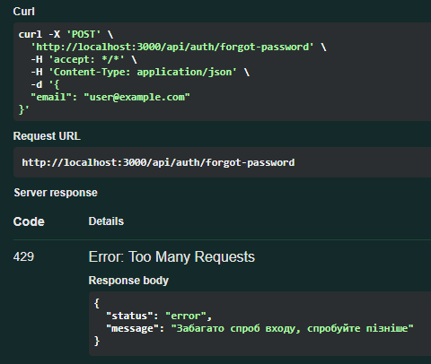

### 4.2 Завантаження кількох файлів

У `src/middleware/upload.js` додано другий екземпляр multer (`uploadMany`) без обмеження `files: 1`; кількість файлів обмежує маршрут (`upload.array("files", 10)`). Контролер `uploadFiles` у `src/controllers/fileController.js` при помилці БД видаляє всі вже збережені файли (і записи, і файли з диска).

```bash
curl -X POST http://localhost:3000/api/files/upload-multiple \
  -H "Authorization: Bearer $TOKEN" \
  -F "files=@a.png" -F "files=@b.pdf" -F "files=@c.jpg"
```

Очікується `201` і `"message": "Завантажено файлів: 3"`. Іншим користувачем надсилається 11 файлів — очікується `400`.

Скріншот відповіді з трьома файлами: 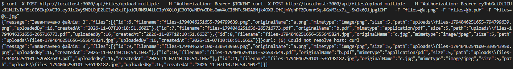

### 4.3 Журнал дій користувачів

Додано модель `AuditLog` (користувач, дія `<сутність>.<операція>`, сутність, id сутності, IP, JSON-деталі, час) та міграцію. Функція `logAction` (`src/utils/audit.js`) викликається неблокуюче з контролерів: auth (реєстрація, вхід, невдалий вхід, вихід, зміна/скидання пароля, 2FA), файлів та CRUD товарів.

Перегляд журналу — лише ADMIN, з пагінацією та фільтрами (`userId`, `action`, `entity`, `entityId`, `from`, `to`):

```bash
# створюємо і видаляємо товар, щоб у журналі з'явилися записи
curl -X POST http://localhost:3000/api/products -H "Authorization: Bearer $TOKEN" \
  -H "Content-Type: application/json" \
  -d '{"sku":"LAB-001","name":"Тестовий товар","price":10,"categoryId":1}'

curl "http://localhost:3000/api/audit-logs?limit=5" -H "Authorization: Bearer $TOKEN"
```

Очікується `200` і записи `product.create`, `auth.login` тощо з IP та деталями. Спроба того самого запиту під токеном WORKER повертає `403`.

Скріншот відповіді `/api/audit-logs`: 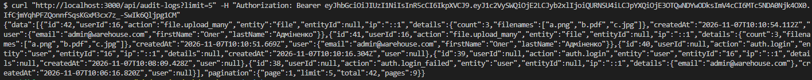

### 4.4 Детальні дозволи

Створено `src/config/permissions.js` — мапу «роль → дозволи» (наприклад, `products:write`, `users:manage`, `audit:read`) та middleware `requirePermission()`. У маршрутах товарів і користувачів він замінив перевірку ролей `authorize()`.

Перевірка: користувач з роллю WORKER (`worker@warehouse.com`) намагається створити товар:

```bash
curl -X POST http://localhost:3000/api/products -H "Authorization: Bearer $WORKER_TOKEN" \
  -H "Content-Type: application/json" \
  -d '{"sku":"LAB-002","name":"Товар","price":10,"categoryId":1}'
```

Очікується `403` і повідомлення з назвою відсутнього дозволу: `...потрібен дозвіл: products:write`.

Скріншот відповіді 403: 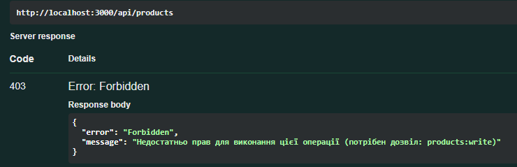

### 4.5 Відновлення пароля

Додано модель `PasswordResetToken` (у БД зберігається лише SHA-256 хеш одноразового токена, діє 15 хвилин), пакет nodemailer та `src/utils/mailer.js`. Для розробки використано тестову скриньку Ethereal: SMTP-змінні в `.env` не задані — прев'ю кожного листа виводиться в консоль сервера.

```bash
curl -X POST http://localhost:3000/api/auth/forgot-password \
  -H "Content-Type: application/json" -d '{"email":"admin@warehouse.com"}'
```

Відповідь **завжди `200`** з однаковим текстом — з неї не можна дізнатися, чи існує email (перевіряється і на неіснуючому адресі).

Далі: у консолі сервера береться посилання-прев'ю Ethereal, з листа копіюється токен, і пароль скидається:

```bash
curl -X POST http://localhost:3000/api/auth/reset-password \
  -H "Content-Type: application/json" \
  -d '{"token":"<токен з листа>","password":"NewPassword456"}'
```

Очікується `200`. Вхід зі старим паролем дає `401`, з новим — `200`. Повторне використання того ж токена дає `400`. Після скидання всі refresh-токени користувача відкликано (усі сесії завершено).

Скріншоти: консоль із прев'ю Ethereal , лист у браузері 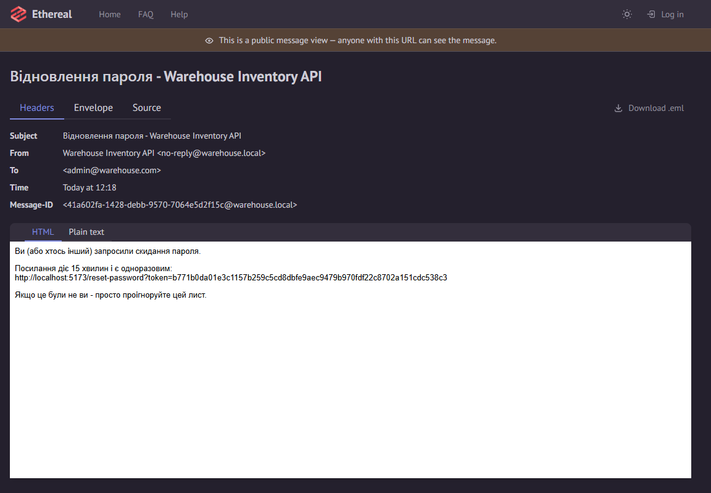, вхід зі старим паролем 401 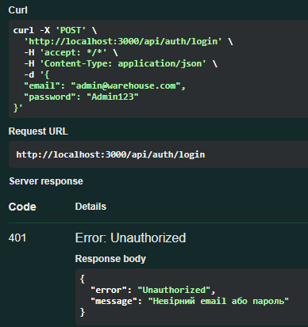

### 4.6 Двофакторна автентифікація

До моделі `User` додано поля `twoFactorSecret` та `twoFactorEnabled`; використано пакети otplib (TOTP) та qrcode. Схема увімкнення — два кроки:

```bash
# крок 1: секрет + otpauth-URL + QR-код (data URL)
curl -X POST http://localhost:3000/api/auth/2fa/setup -H "Authorization: Bearer $TOKEN"

# крок 2: код із застосунку-аутентифікатора
curl -X POST http://localhost:3000/api/auth/2fa/enable -H "Authorization: Bearer $TOKEN" \
  -H "Content-Type: application/json" -d '{"code":"123456"}'
```

QR-код сканується застосунком-аутентифікатором (Google Authenticator). Після увімкнення 2FA вхід стає двокроковим:

```bash
# крок 1: логін повертає twoFactorRequired: true і tempToken (діє ~5 хв)
curl -X POST http://localhost:3000/api/auth/login \
  -H "Content-Type: application/json" -d '{"email":"admin@warehouse.com","password":"Admin123"}'

# крок 2: повна пара токенів видається лише після кода
curl -X POST http://localhost:3000/api/auth/2fa/verify \
  -H "Content-Type: application/json" -d '{"tempToken":"<tempToken>","code":"<код з додатку>"}'
```

Невірний код на будь-якому кроці дає `400`/`401`. Вимкнення (`/2fa/disable`) також потребує чергового кода з аутентифікатора.

Скріншоти: відповідь `/2fa/setup` з QR-кодом 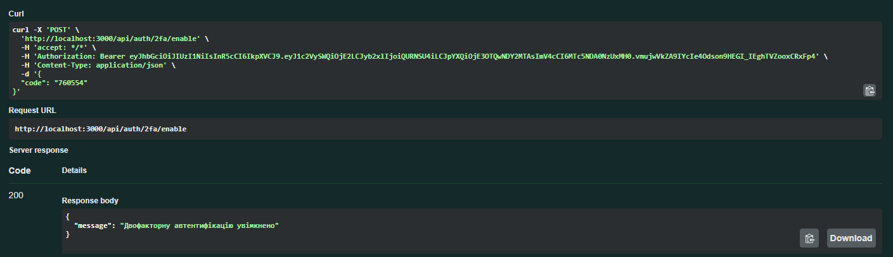, вхід із `twoFactorRequired` 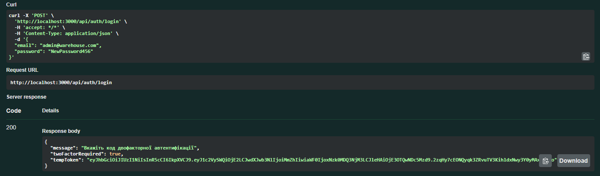

### 4.7 Вхід через GitHub OAuth

Створено OAuth App на GitHub (github.com/settings/developers) з callback URL `http://localhost:3000/api/auth/github/callback`; `GITHUB_CLIENT_ID` та `GITHUB_CLIENT_SECRET` додано в `.env`. Реалізація — без passport, лише `fetch`: обмін коду на access_token, отримання профілю та email, пошук/створення користувача, прив'язка через модель `OAuthAccount`, видача пари JWT та редирект на фронтенд.

Потік перевіряється у браузері:

1. Відкрити `http://localhost:3000/api/auth/github` — редирект на сторінку авторизації GitHub.
2. Натиснути «Authorize» — редирект на `FRONTEND_URL/oauth/callback?accessToken=...&refreshToken=...`.
3. Отриманим access-токеном виконати `GET /api/auth/profile` — `200` з профілем GitHub-користувача.

Захист від CSRF забезпечується параметром `state`, який генерується перед редиректом і перевіряється в callback. Повторний вхід під тим самим акаунтом GitHub не створює дубліката користувача.

Скріншоти: сторінка авторизації GitHub 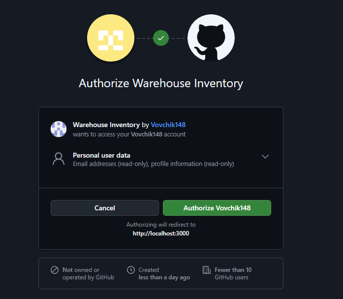), редирект з токенами 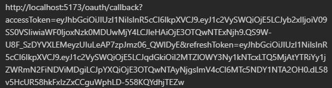

### 4.8 Розширена документація API

У `src/config/swagger.js` до компонентів Swagger додано схеми (`User`, `Tokens`, `TwoFactorRequired`, `File`, `Product`, `AuditLog`, `Error`, `Pagination` тощо), спільні описи відповідей помилок та приклади. Оновлено `api_documantion.md` — розділи з прикладами запитів для кожного нового механізму.

Скріншот Swagger UI зі схемами компонентів: 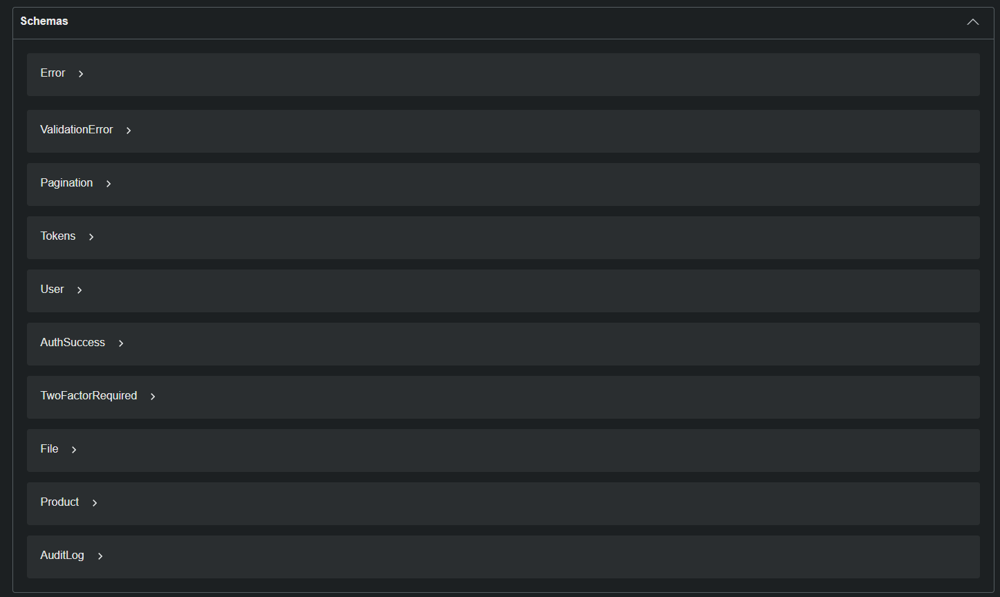

### 4.9 Тестування

Для кожного механізму написано тести (node:test + supertest): `tests/rateLimit.test.js`, `tests/filesMultiple.test.js`, `tests/audit.test.js`, `tests/passwordReset.test.js`, `tests/twoFactor.test.js`, `tests/oauth.test.js`.

```bash
npm test
```

Усі тести проходять успішно.

Скріншот результатів тестів: 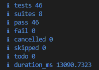

## 5. Висновки

У ході виконання лабораторної роботи я закріпив навички захисту серверної частини вебдодатку: налаштував rate limiting із параметрами змінними середовища, реалізував незмінний журнал аудиту дій, замінив перевірку ролей системою детальних дозволів, додав відновлення пароля через одноразові токени та email (з тестовою скринькою Ethereal), двофакторну автентифікацію за стандартом TOTP і вхід через GitHub OAuth без сторонніх бібліотек. Окремо опанував захисні практики: відповідь «завжди 200» проти перебору email, зберігання в БД лише хешів одноразових токенів, відкликання всіх сесій після скидання пароля та CSRF-захист OAuth-потоку.
