# Звіт з лабораторної роботи №3

**Тема:** Взаємодія в реальному часі та фіналізація серверної частини  
**Предметна область:** Система обліку інвентарю на складі  
**Виконав:** Шипкін Денис  
**Репозиторій:** https://github.com/Vovchik148/Web.git  
**Розгорнутий застосунок:** https://warehouse-inventory-api-700g.onrender.com

## 1. Мета роботи

Здобути практичні навички впровадження обміну даними в реальному часі у вебзастосунки з використанням технології WebSocket, навчитися оптимізувати роботу з базою даних, проводити комплексне тестування серверних застосунків та розгортати їх на хостингу.

## 2. Що додається до застосунку

Застосунок з попередніх лабораторних робіт (Express.js + PostgreSQL + Prisma, JWT-автентифікація з ротацією, CRUD, складський облік, аудит, 2FA, OAuth) розширено функціональністю реального часу та інфраструктурними механізмами:

| № рівня | Механізм | Реалізація |
|---|---|---|
| 1 | Socket.io в Express.js | `src/socket/index.js`, HTTP-сервер через `node:http`, `app.set('io', ...)` |
| 1 | Базове WebSocket-підключення + автентифікація за JWT | middleware `io.use()` з `verifyAccessToken`, помилка `unauthorized` |
| 1 | Система кімнат | `room:join`/`room:leave` з ack, білий список кімнат: `products`, `categories`, `suppliers`, `warehouses`, `warehouse:<id>`; персональна `user:<id>` приєднується автоматично |
| 1 | Оновлення в реальному часі | Події `product:created/updated/deleted`, `stock:updated`, `movement:created`, `category:*`, `supplier:*`, `warehouse:*` з усіх контролерів |
| 1 | Система сповіщень | Модель `Notification` (типи, пріоритети), сервіс `src/services/notificationService.js`, REST `/api/notifications` |
| 2 | Персоналізовані сповіщення з типами і пріоритетами | Enum `NotificationType` (LOW_STOCK, MOVEMENT, SYSTEM, PRODUCT) та `NotificationPriority` (LOW…CRITICAL); batch-розсилка через чергу |
| 2 | Онлайн-статус | `src/socket/presence.js`, події `presence:update` / `presence:list`, підтримка кількох вкладок |
| 2 | Reconnection з відновленням подій | Історія в таблиці `event_logs` з порядковим номером `_seq`, подія клієнта `events:sync` |
| 2 | Комплексна оптимізація БД | Складені індекси, кеш списків з інвалідацією, усунення зайвих запитів, low-stock звіт одним агрегатним SQL |
| 3 | Горизонтальне масштабування | Redis-адаптер `@socket.io/redis-adapter` (за наявності `REDIS_URL`) |
| 3 | Rate limiting подій WebSocket | Токенне відро на сокет, `src/socket/rateLimit.js`, `WS_RATE_LIMIT_*` у `.env` |
| 3 | Черги фонових задач | BullMQ + Redis (`src/services/queue.js`) з fallback на виконання в пам'яті |
| 3 | Розширене кешування | `src/utils/cache.js`: Redis або пам'ять процесу, `cache.wrap()`, інвалідація префіксами |
| 3 | Метрики та моніторинг | `prom-client`, `src/utils/metrics.js`, ендпоінт `GET /metrics` |
| 3 | Розгортання | Render (web) + Neon (PostgreSQL), `prisma migrate deploy`, health-check `/health` |
| 3 | Документація WebSocket API | `docs/WEBSOCKET_API.md`, `docs/DEPLOYMENT.md`, розділ у README |

## 3. Технології

Node.js, Express.js 5, PostgreSQL, Prisma ORM, **Socket.io 4**, **Redis (ioredis)**, **BullMQ**, **@socket.io/redis-adapter**, **prom-client**, JWT, socket.io-client (для тестів і демонстрації), node:test + supertest, Render (PaaS), Neon (serverless PostgreSQL).

## 4. Хід роботи

> Усі демонстрації виконуються при запущених контейнерах (`docker compose up -d` — PostgreSQL + Redis) та сервері (`npm run dev`).
> Для зручності є готовий демо-скрипт, який показує всю функціональність реального часу одним запуском:
>
> ```bash
> npm run db:seed
> npm run dev
> node --env-file=.env scripts/ws-demo.mjs
> ```

### 4.1 Інтеграція Socket.io та автентифікація WebSocket-з'єднань

Socket.io підключено не до `app`, а до HTTP-сервера (`src/server.js` створює його через `createServer(app)`). Автентифікація — в middleware підключення: клієнт передає JWT access-токен у `handshake.auth.token`, сервер перевіряє його `verifyAccessToken()` і записує користувача в `socket.user`. Підключення без/з невалідним токеном відхиляється з помилкою `unauthorized`. Коли токен спливає, клієнт оновлює його через `POST /api/auth/refresh` і перепідключається.

Демонстрація (термінал 2):

```bash
node --env-file=.env scripts/ws-demo.mjs
```

Скрипт спочатку намагається підключитися без токена — сервер відхиляє з'єднання:

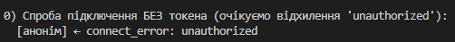

— відхилення підключення без токена.

### 4.2 Кімнати та оновлення в реальному часі

Кімнати предметної області: довідники (`products`, `categories`, `suppliers`, `warehouses`), окремий склад (`warehouse:<id>`), персональна кімната користувача (`user:<id>`, приєднується автоматично). Приєднання — подією `room:join` з підтвердженням (acknowledgement): `{ ok: true }`; до невідомої кімнати приєднатися не можна (білий список шаблонів на сервері).

Далі демо-скрипт приєднує обох клієнтів (admin + worker) до кімнати одного складу і реєструє рух товару через REST `POST /api/movements`. Обидва клієнти миттєво отримують події `stock:updated` (новий залишок) та `movement:created` (сама операція) з службовими полями `_seq`, `_room`, `_type`:

Події генеруються в контролерах через сервіс `src/services/realtime.js` (`publishEvent(room, type, payload)`): кожна подія зберігається в таблицю `event_logs` (порядковий номер = id) і розсилається в кімнату. Це дає і розсилку, і історію для відновлення після reconnect (пп. 4.4).

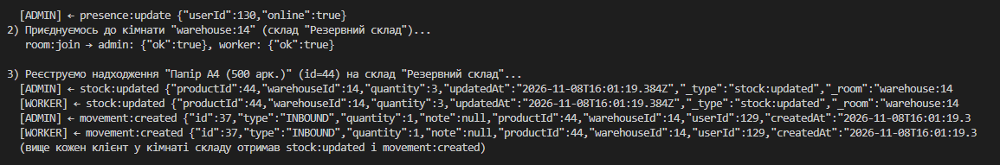

— події реального часу в двох клієнтів.

### 4.3 Онлайн-статус користувачів

При підключенні сервер приєднує сокет до кімнати `presence` і транслює в неї `presence:update { userId, online: true }`; після відключення останнього сокета користувача — `online: false`. Новий клієнт отримує повний список `presence:list`. Один користувач з кількома вкладками (сокетами) вважається онлайн, доки відкритий хоча б один.

У виводі демо-скрипта це видно при підключенні:

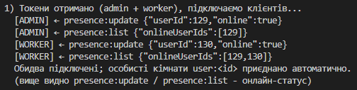

— онлайн-статус.

### 4.4 Відновлення пропущених подій після перепідключення

Socket.io перепідключається автоматично, але події, що сталися офлайн, втрачаються. Механізм відновлення:

1. кожна подія зберігається в `event_logs` (порядковий номер `_seq`);
2. клієнт зберігає останній отриманий `_seq`;
3. після reconnect викликає `events:sync(lastSeq)` — сервер повертає всі події кімнат клієнта з номером більшим за останній (до 100 за раз), у порядку зростання.

Демонстрація в демо-скрипті (крок 4): третій клієнт підключається «пізно» і запитує все, що сталося після останнього баченого ним `_seq` — сервер повертає пропущені `stock:updated` і `movement:created`:

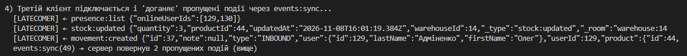

— відновлення пропущених подій.

### 4.5 Система сповіщень з типами та пріоритетами

Спроєктовано модель `Notification` (отримувач, тип `LOW_STOCK|MOVEMENT|SYSTEM|PRODUCT`, пріоритет `LOW|NORMAL|HIGH|CRITICAL`, title/message, JSON-дані, час прочитання). Кожне сповіщення зберігається в БД і доставляється в реальному часі подією `notification` в особисту кімнату `user:<id>`.

Генерація: при русі товару контролер порівнює сумарний залишок з `minStock`; якщо залишок нижчий — сервіс `notifyLowStock()` створює сповіщення всім активним ADMIN і MANAGER **через чергу фонових задач** (batch), щоб не навантажувати HTTP-запит. Повторні сповіщення про той самий товар не спамлять: попередні непрочитані LOW_STOCK позначаються прочитаними.

REST API (усі ендпоінти працюють лише зі «своїми» сповіщеннями):

```
GET    /api/notifications            - список (пагінація; фільтри unread, type, priority)
GET    /api/notifications/unread-count
PATCH  /api/notifications/:id/read
PATCH  /api/notifications/read-all
DELETE /api/notifications/:id
```

Демонстрація (крок 5 демо-скрипта): створюється товар з `minStock=100`, оприбутковується 10 одиниць — адмін негайно отримує персональне сповіщення з пріоритетом `HIGH` (через чергу BullMQ):

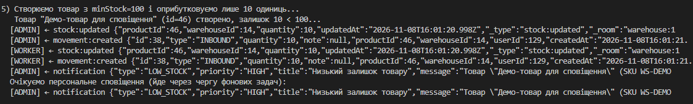

— персональне сповіщення про низький залишок.

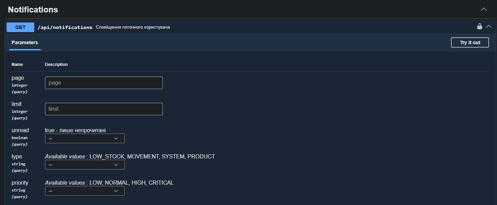

— Swagger з ендпоінтами сповіщень.

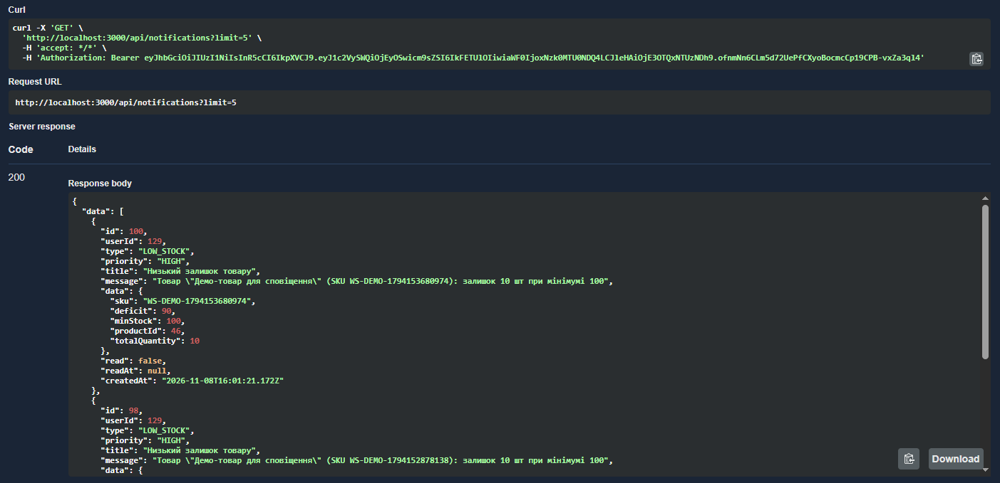

— виконання `GET /api/notifications` через Swagger.

### 4.6 Оптимізація бази даних

**Індекси.** У `schema.prisma` додано: складені `stock_movements(productId, createdAt)` та `stock_movements(warehouseId, createdAt)` (фільтр за товаром/складом + сортування журналу за датою), `stocks(warehouseId)`, `notifications(userId, readAt)` і `notifications(userId, createdAt)` (список та лічильник непрочитаних), `event_logs(room, id)` (вибірка пропущених подій). Порівняння плану виконання — п. 4.6.1.

**Пагінація** — усі списки (товари, рухи, залишки, сповіщення, аудит) мають `page`/`limit` із верхньою межею 100 записів.

**Кешування.** `src/utils/cache.js`: список категорій/постачальників/складів/товарів кешується на 60 с (`cache.wrap()`), при кожній мутації контролер інвалідовує ключі префікса (`cache.delPrefix('category:list')`), тому застарілі значення не віддаються. Сховище — Redis за наявності `REDIS_URL`, інакше пам'ять процесу.

**Оптимізація запитів.** Звіт `/api/stock/low` переписано з завантаження всіх товарів разом із залишками (include) і фільтрацією в JavaScript на **один агрегатний SQL-запит** (`JOIN + GROUP BY + HAVING`) — база віддає лише ті кілька рядків, що реально в дефіциті.

#### 4.6.1 EXPLAIN ANALYZE: до і після індексу

Демонструється на журналі руху (`stock_movements`) — типова комбінація «фільтр за складом + сортування за датою». Спочатку наповнюємо таблицю тестовими даними і вимикаємо складений індекс, щоб побачити план «до»:

```bash
# 1) тестові дані (20 000 рухів; видалимо їх після демо)
docker exec -it warehouse-postgres-1 psql -U warehouse_user -d warehouse_db -c "
INSERT INTO stock_movements (type, quantity, \"productId\", \"warehouseId\", \"userId\", \"note\", \"createdAt\")
SELECT 'ADJUSTMENT', 1, 1, 1, 1, 'demo-lab3', now() - (i || ' seconds')::interval
FROM generate_series(1, 20000) i;"

# 2) тимчасово прибираємо складений індекс
docker exec -it warehouse-postgres-1 psql -U warehouse_user -d warehouse_db -c '
DROP INDEX "stock_movements_warehouseId_createdAt_idx";'

# 3) план БЕЗ індексу
docker exec -it warehouse-postgres-1 psql -U warehouse_user -d warehouse_db -c '
EXPLAIN ANALYZE SELECT * FROM stock_movements
WHERE "warehouseId" = 1 ORDER BY "createdAt" DESC LIMIT 20;'
```

План «до»: `Seq Scan on stock_movements` + Top-N sort — база читає всі 20 000 рядків.

Повертаємо індекс (той самий, що створює міграція) і повторюємо запит:

```bash
# 4) індекс назад
docker exec -it warehouse-postgres-1 psql -U warehouse_user -d warehouse_db -c '
CREATE INDEX "stock_movements_warehouseId_createdAt_idx"
  ON stock_movements ("warehouseId", "createdAt");'

# 5) план З ІНДЕКСОМ - той самий запит
docker exec -it warehouse-postgres-1 psql -U warehouse_user -d warehouse_db -c '
EXPLAIN ANALYZE SELECT * FROM stock_movements
WHERE "warehouseId" = 1 ORDER BY "createdAt" DESC LIMIT 20;'
```

План «після»: `Index Scan Backward using stock_movements_warehouseId_createdAt_idx` — читається лише ~20 рядків, час у десятки разів менший.

```bash
# 6) прибирання тестових даних
docker exec -it warehouse-postgres-1 psql -U warehouse_user -d warehouse_db -c "
DELETE FROM stock_movements WHERE \"note\" = 'demo-lab3';"
```

> Примітка: назву контейнера `warehouse-postgres-1` звір зі своїм (`docker ps`).
> У Postgres-контейнерах Docker обов'язково видувається -it та лапки навколо camelCase-колонок.

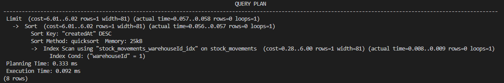

— план «до» (Seq Scan).

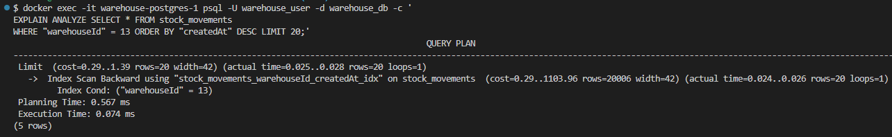

— план «після» (Index Scan).

Додатково для пошуку повільних запитів реалізовано журналювання SQL: `PRISMA_QUERY_LOG=1` у `.env` вмикає вивід кожного запиту з часом виконання (`[sql] 12ms SELECT ...`) — ці запити потім аналізуються через `EXPLAIN ANALYZE`.

### 4.7 Rate limiting подій WebSocket

Події клієнт → сервер лімітуються «токенним відром» на кожен сокет (за замовчуванням 30 подій/с, параметри `WS_RATE_LIMIT_EVENTS`, `WS_RATE_LIMIT_WINDOW_MS`). При перевищенні сервер шле клієнту подію `error` («Забагато подій...»), а ack-виклики отримують `{ ok: false, error: 'rate_limited' }`.

Це покрито тестом `rate limiting: шторм подій відкидається` у `tests/socket.test.js` (50 швидких подій → сервер відкидає надлишок). Див. скріншот тестів у п. 4.10.

### 4.8 Черги фонових задач, кешування та Redis-адаптер

**Черги (BullMQ).** `src/services/queue.js` надає `enqueue(name, data)` з повторними спробами (attempts: 3, exponential backoff). Через чергу виконуються: batch-розсилка сповіщень (`notification.batch`) — клієнт, що викликав рух товару, не чекає на запис сповіщень усім менеджерам. Без `REDIS_URL` черга чесно деградує: задачі виконуються одразу у фоні того ж процесу.

**Кешування** описано в п. 4.6. Влучання/промахи кешу лічаться в метриках `cache_hits_total` / `cache_misses_total`.

**Redis-адаптер.** Якщо заданий `REDIS_URL`, `initSocket()` вмикає `createAdapter(pubClient, subClient)` — події через Redis pub/sub досягають клієнтів будь-якого екземпляра сервера. При запуску сервера це видно в логах:

```
[redis] Підключено за адресою redis://localhost:6379
[socket] Redis-адаптер увімкнено (горизонтальне масштабування)
```

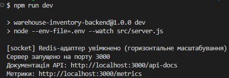

— лог сервера з Redis-адаптером і чергою.

### 4.9 Метрики та моніторинг

Додано `GET /metrics` (prom-client): HTTP-лічильники та гістограми (`http_requests_total`, `http_request_duration_seconds`), WebSocket (`ws_connections_active`, `ws_connections_total`, `ws_events_total`, `ws_rejected_total`, `ws_rate_limited_total`), кеш (`cache_hits_total`, `cache_misses_total`), БД (`db_query_duration_seconds`), черги (`queue_jobs_total`). Плюс два health-check ендпоінти: `GET /health` (без БД) та `GET /api/health` (перевіряє БД).

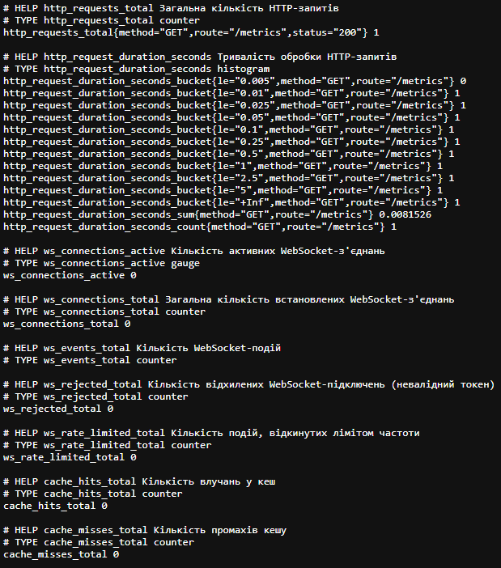

— метрики Prometheus.

### 4.10 Тестування

Для лабораторної №3 додано тести (node:test + socket.io-client + supertest):

- `tests/socket.test.js` — автентифікація WS (без/з невалідним токеном → `unauthorized`), кімнати з ack, персональні сповіщення, невідома кімната, presence, `events:sync`, rate limiting, наскрізний сценарій «створення товару через REST → подія в кімнаті products»;
- `tests/notifications.test.js` — CRUD сповіщень, фільтри, batch-розсилка, «чуже» сповіщення → 404, наскрізний сценарій «рух нижче мінімуму → LOW_STOCK сповіщення з пріоритетом HIGH»;
- `tests/monitoring.test.js` — кеш (wrap/інвалідація префіксів), `/health`, `/metrics`.

```bash
npm test
```

Усі 68 тестів проходять успішно (52 з попередніх лабораторних + 16 нових).

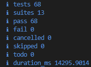

— результати тестів.

### 4.11 Розгортання на хостингу

Обрано **Render** (безкоштовний web service, підтримка Node.js і WebSocket) + **Neon** (безстрокова безкоштовна PostgreSQL; у Render база безкоштовно діє лише 30 днів). Міграції застосовуються командою `npx prisma migrate deploy` у Start Command (не `migrate dev` — вона лише для розробки).

| Параметр Render | Значення |
|---|---|
| Build Command | `npm ci && npx prisma generate` |
| Start Command | `npx prisma migrate deploy && node src/server.js` |
| Health Check Path | `/health` |
| Region | Frankfurt (EU Central) |
| Environment | `DATABASE_URL` (Neon, з `sslmode=require`), `JWT_SECRET`, `REFRESH_TOKEN_SECRET`, `FRONTEND_URL`, `APP_URL`, `NODE_ENV=production` |

Порядок: створено проєкт у Neon → `npx prisma migrate deploy` локально проти Neon-бази (створила всі таблиці) → Web Service на Render, підключений до репозиторію → задано змінні середовища → деплой.

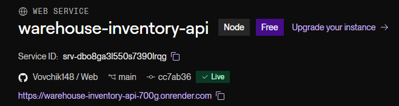

— дашборд Render, статус Live.

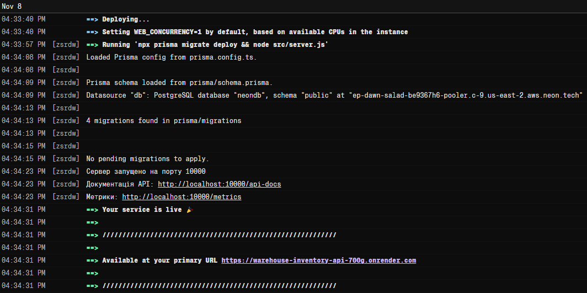

— лог першого деплою.

Перевірка production-ендпоінтів:

- `GET https://...onrender.com/health` → `{"status":"ok",...}`
- `GET https://...onrender.com/api/health` → `{"status":"ok","database":"connected",...}`
- `GET https://...onrender.com/api-docs` → Swagger
- `GET https://...onrender.com/metrics` → метрики

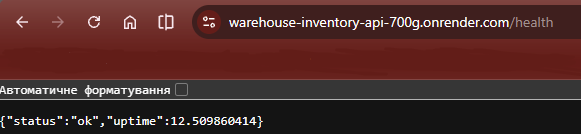
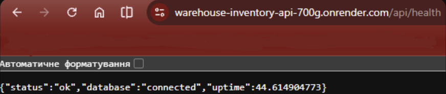

— health-check'и на production.
Як зробити: відкрий у браузері обидві адреси `.../health` та `.../api/health` (підстав свій URL); сфотографуй так, щоб було видно адресний рядок і JSON-відповідь з `"database":"connected"`.

**Поведінка після «засинання» (перевірено):** після 15 хвилин без запитів безкоштовний сервіс «засинає»; перший запит триває до хвилини (холодний старт), WebSocket-з'єднання розриваються — клієнти Socket.io перепідключаються автоматично, а пропущені події відновлюються механізмом `events:sync` (пп. 4.4). Обмеження тарифу зафіксовані в `docs/DEPLOYMENT.md`.

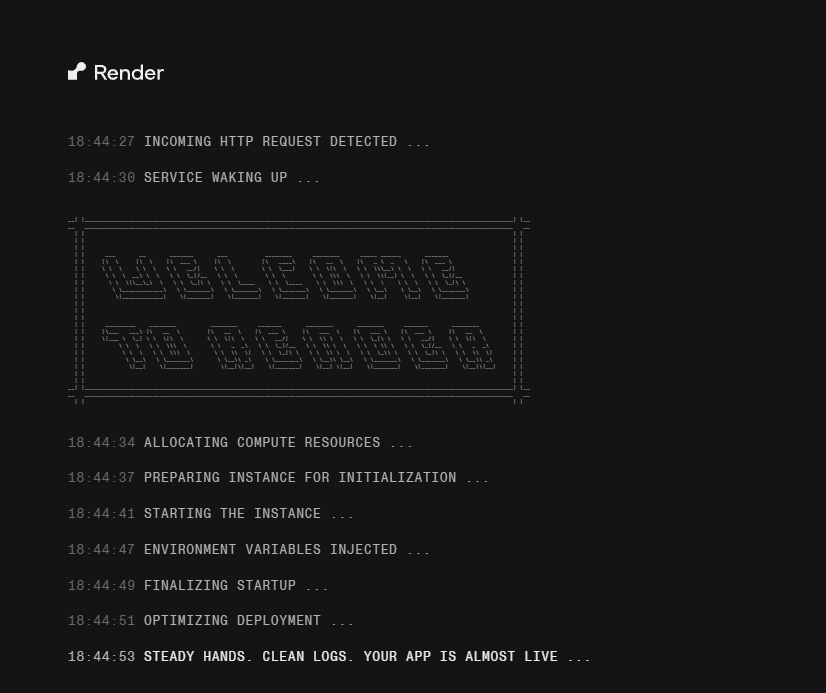

— холодний старт.

### 4.12 Документація

- `docs/WEBSOCKET_API.md` — повний опис WebSocket API: підключення з токеном, кімнати, усі події сервер→клієнт і клієнт→сервер, формат службових полів `_seq/_room/_type`, механізм `events:sync` з прикладом коду клієнта, обмеження частоти, метрики;
- `docs/DEPLOYMENT.md` — розгортання на Render: обмеження безкоштовного тарифу, sticky sessions (потрібні за кількох екземплярів), як налаштовується автоматичне масштабування;
- `README.md` — оновлено: нові ендпоінти (сповіщення, моніторинг), розділ WebSocket, інструкція демонстрації (`scripts/ws-demo.mjs`), адреса production;
- Swagger (`/api-docs`) — додано секцію Notifications.

## 5. Висновки

У ході виконання лабораторної роботи я впровадив у серверну частину повноцінний обмін даними в реальному часі: інтегрував Socket.io з автентифікацією WebSocket-з'єднань за JWT, спроєктував систему кімнат предметної області, реалізував наживу оновлення всіх основних сутностей, персоналізовану систему сповіщень з типами, пріоритетами та batch-розсилкою через чергу фонових задач, індикатори онлайн-статусу та механізм відновлення пропущених подій після розриву з'єднання. З боку інфраструктури — провів оптимізацію бази даних (складені індекси з перевіркою через EXPLAIN ANALYZE, кешування з інвалідацією, агрегатні запити замість обробки в застосунку), додав черги BullMQ, Redis-адаптер для горизонтального масштабування, метрики Prometheus і повне тестування (68 тестів), після чого розгорнув застосунок на Render з базою Neon і зафіксував поведінку сервісу за обмежень безкоштовного тарифу.
