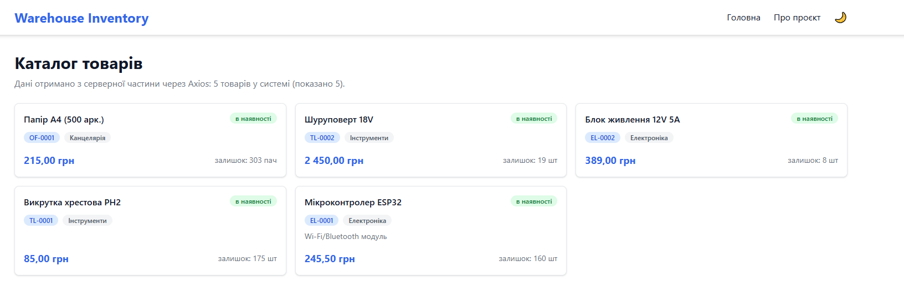
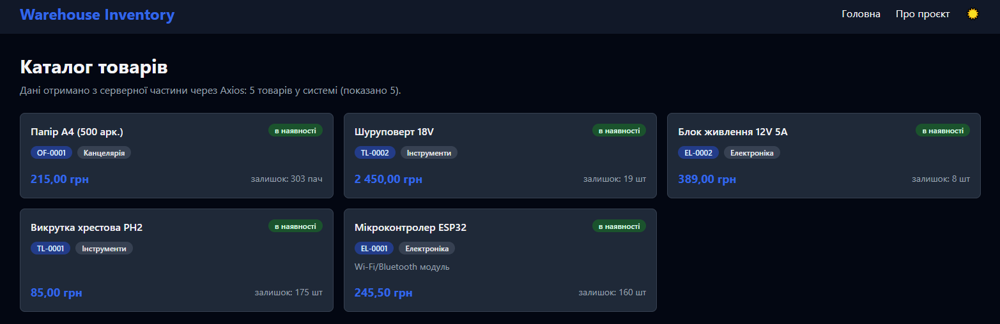
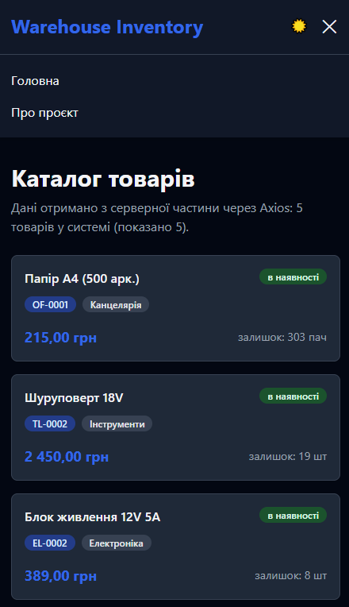
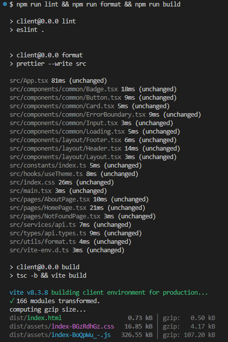

# Звіт з лабораторної роботи №4

**Тема:** Реалізація React-проєкту  
**Предметна область:** Система обліку інвентарю на складі  
**Виконав:** Шипкін Денис  
**Репозиторій:** https://github.com/Vovchik148/Web.git (клієнт — у теці `client/`)

## 1. Мета роботи

Здобути практичні навички створення сучасного React-проєкту з використанням TypeScript, налаштування інструментів розробки та побудови базової архітектури клієнтської частини застосунку з використанням Tailwind CSS для стилізації.

## 2. Що зроблено

| Рівень | Завдання | Реалізація |
|---|---|---|
| 1 | React-проєкт з Vite та TypeScript | `client/`, `npm create vite@latest -- --template react-ts` |
| 1 | Tailwind CSS 4 | плагін `@tailwindcss/vite`, стилі лише в `src/index.css` (без `tailwind.config.js`) |
| 1 | ESLint + Prettier | ESLint 10 flat config + typescript-eslint, oxlint замінено; `.prettierrc`, скрипти `lint`/`format` |
| 1 | React Router 8 | пак. `react-router`, сторінки Home / About / NotFound |
| 1 | Axios | `src/services/api.ts` з baseURL з `VITE_API_URL` |
| 1 | Структура папок | `components/{common,layout}`, `pages`, `services`, `types`, `utils`, `hooks`, `constants` |
| 1 | Адаптивний макет | сітки `sm:`/`lg:`, бургер-меню в `Header` |
| 2 | UI-компоненти | `Button` (variant/size/isLoading), `Input` (ref як проп, без forwardRef), `Card`, `Badge`, `Loading` |
| 2 | Header / Footer / Layout | навігація з констант `NAV_ITEMS`, перемикач теми, `<Outlet />` |
| 2 | Кольори і типографіка | директива `@theme`: палітра `primary-*`, шрифт Inter |
| 2 | Loading | спінер з текстом, `role="status"` |
| 3 | Змінні середовища | `.env` / `.env.development` / `.env.production` / `.env.example`, типізовані в `vite-env.d.ts` |
| 3 | Типи TypeScript для API | `src/types/api.types.ts` під формат реального backend (пагінація `{data, pagination}`, Decimal → string) |
| 3 | Axios interceptors | request: `Bearer` токен з localStorage; response: 401 з наявним токеном → очищення + redirect на `/login` |
| 3 | Error Boundary | класовий компонент навколо `<Outlet />` у Layout |
| 3 | Абсолютні імпорти `@/` | `paths` у `tsconfig.app.json` + `resolve: { tsconfigPaths: true }` у Vite |
| 3 | Утиліти форматування | `src/utils/format.ts`: `formatDate`, `formatPrice`, `formatQuantity`, `truncate` |
| 3 | Темна тема | `@custom-variant dark` + клас `.dark` на `<html>`, хук `useTheme` з localStorage |

## 3. Технології

React 19, TypeScript, Vite 8, Tailwind CSS 4, React Router 8, Axios, ESLint 10 (flat config) + Prettier.

## 4. Хід роботи

### 4.1 Створення проєкту та інструменти

```bash
npm create vite@latest client -- --template react-ts
cd client && npm install
npm install tailwindcss @tailwindcss/vite react-router axios
npm uninstall oxlint
npm install -D eslint @eslint/js typescript-eslint eslint-plugin-react-hooks eslint-plugin-react-refresh globals prettier eslint-config-prettier
```

Два рішення, які варто окремо пояснити:

1. **TypeScript 5.9 замість 7.** Шаблон Vite постачає TypeScript 7 (Go-based), але `typescript-eslint@8` має peer-залежність `typescript < 6.1.0` і з ним не працює. Знижено до стабільної `~5.9.0` — компроміс на користь повноцінного ESLint.
2. **Кешування маршрутів у константах.** Назви маршрутів і пункти меню винесено в `src/constants/index.ts` (`ROUTES`, `NAV_ITEMS`) — навігація в `Header` і конфігурація `App.tsx` використовують одне джерело істини.

Якість коду: `npm run lint` (ESLint) і `npm run format` (Prettier) — без помилок; скрипт `lint` у `package.json` замінено з oxlint на `eslint .`.



— головна сторінка (світла тема): каталог товарів з живими даними серверної частини.

### 4.2 Архітектура, маршрутизація, робота з API

Структура папок — за методомичкою (`components/common`, `components/layout`, `pages`, `services`, `types`, `utils`, `hooks`, `constants`); імпорти скрізь абсолютні: `@/components/common/Button`.

Маршрутизація (`src/App.tsx`): `Layout` з `<Outlet />` — батьківський маршрут, всередині — сторінки; catch-all `*` винесено на верхній рівень, бо в React Router 8 splat-нащадок того ж батька перехоплював би індексний маршрут `/`.

Axios (`src/services/api.ts`): request-interceptor додає `Bearer` токен з localStorage до кожного запиту; response-interceptor при 401 **з наявним токеном** (прострочений токен) очищає його і редиректить на `/login`. Якщо токена не було (гість) — редирект не виконується, сторінка сама показує коректний стан: каталог вимагає авторизації, і гість бачить повідомлення з кнопкою «Спробувати знову», а не пустий редирект на ще неіснуючу сторінку входу (з'явиться в лаб. 5).

Головна сторінка (`HomePage`) тягне товари через `api.get<PaginatedResponse<Product>>('/products')` — типи відповідають реальному формату backend (лаб. 1-3, включно з `pages` у пагінації та Decimal-ціною у вигляді рядка). Канонічний патерн завантаження: усі `setState` після `await`, скасування через `AbortController` (правило `react-hooks/set-state-in-effect` в ESLint). Товари рендеряться картками `Card` з `Badge` (наявність, SKU, категорія), ціною через `formatPrice` і залишком.

### 4.3 UI-компоненти, розмітка, Error Boundary

`Button` (варіанти primary/secondary/danger, розміри sm/md/lg, стан isLoading), `Input` (у React 19 `ref` — звичайний проп, без forwardRef, що знадобиться для React Hook Form у лаб. 5), `Card`, `Badge` (5 варіантів), `Loading`. Розмітка: `Header` з навігацією з `NAV_ITEMS` і кнопкою теми, `Footer` з контактами, `Layout` — `min-h-screen flex flex-col` + `<Outlet />`, обгорнутий у `ErrorBoundary` (класовий компонент з `getDerivedStateFromError`/`componentDidCatch`).

### 4.4 Темна тема та адаптивність

У `src/index.css`: `@custom-variant dark (&:where(.dark, .dark *))` — класи `dark:...` реагують на клас на `<html>`, а не лише на системну тему; палітра і шрифт — через `@theme`. Хук `useTheme` визначає початкову тему (localStorage або `prefers-color-scheme`), перемикає клас і зберігає вибір.

Адаптивність: сітка каталогу `grid-cols-1 sm:grid-cols-2 lg:grid-cols-3`; у `Header` навігація для десктопу (`hidden sm:flex`) та бургер-меню для мобільних.



— темна тема.



— мобільний вигляд: бургер-меню, сітка в одну колонку.

### 4.5 Змінні середовища

`VITE_API_URL` (адреса API) і `VITE_APP_NAME` (назва в UI). Файли: `.env` (локальний, у `.gitignore`), `.env.development`, `.env.production` (адреса Render), `.env.example`. Типізовано в `vite-env.d.ts`. У змінні з префіксом `VITE_` не зберігаються секрети — вони потрапляють у клієнтський бандл.

## 5. Перевірка

```bash
npm run lint     # ESLint: без помилок
npm run format   # Prettier: без змін
npm run build    # tsc -b && vite build: 326 kB (gzip 107 kB)
```



— lint, форматування та продакшн-білб.

Функціонально перевірено в браузері: каталог з живими даними API, перемикання теми (запам'ятовується після перезавантаження), маршрути `/`, `/about`, довільний URL → 404, стан гостя без токена.

## 6. Висновки

Створено повністю налаштований React-проєкт з TypeScript: Vite 8, Tailwind CSS 4 з власною темою та темною темою через `@custom-variant`, ESLint 10 + Prettier, React Router 8 з layout-маршрутом, Axios з interceptors і типізованими відповідями під формат реального backend, набір повторно використовуваних UI-компонентів, Error Boundary та адаптивний макет. Окремо опрацьовано сумісність TypeScript 7 шаблону з typescript-eslint і ранжування маршрутів React Router 8 (винос catch-all на верхній рівень). Клієнт готовий до наступних лабораторних робіт: автентифікації (React Hook Form), WebSocket та управління складом.