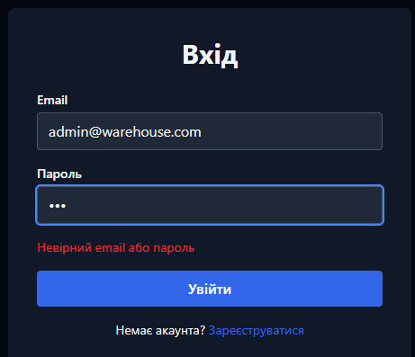
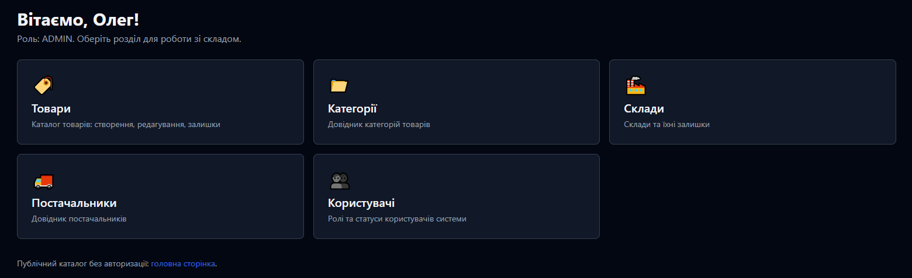
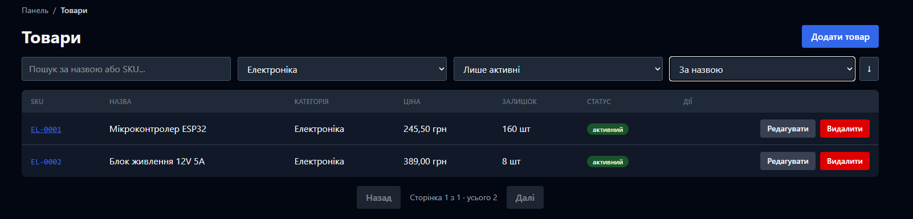
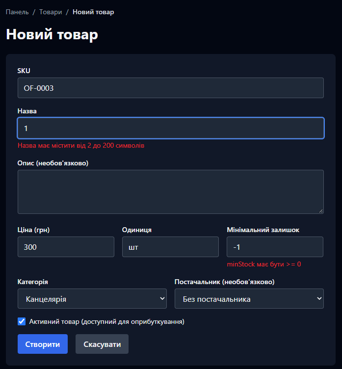
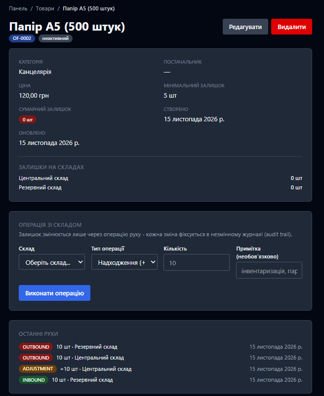
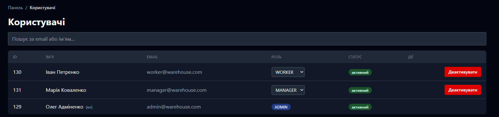

# Звіт з лабораторної роботи №5

**Тема:** Розроблення основного інтерфейсу та функціоналу  
**Предметна область:** Система обліку інвентарю на складі  
**Виконав:** Шипкін Денис  
**Репозиторій:** https://github.com/Vovchik148/Web.git (клієнт — у теці `client/`)

## 1. Мета роботи

Здобути практичні навички створення повнофункціонального користувацького інтерфейсу із системою аутентифікації, керуванням станом, валідацією форм та реалізацією CRUD-операцій для взаємодії з API серверної частини.

## 2. Що зроблено

| Рівень | Завдання | Реалізація |
|---|---|---|
| 1 | Login / Register | React Hook Form + Zod 4; правила схем дублюють валідатори backend (пароль 8-72 з регістрами та цифрою, ім'я 2-50) |
| 1 | Аутентифікація через Zustand | `stores/authStore.ts` з middleware `persist` (сесія у localStorage, ключ `auth-storage`) |
| 1 | Захищені маршрути | `ProtectedRoute` з `state.from` (повернення після входу) та опційною перевіркою ролей |
| 1 | Dashboard | картки розділів з масиву; розділи фільтруються за роллю користувача |
| 1 | Logout | відкликання refresh-токена на сервері (`POST /auth/logout`) + очищення сесії |
| 1 | Індикатори завантаження / помилки | Loading, Skeleton (таблиця/сітка/детальна), `ErrorAlert`, централізований `getErrorMessage` |
| 2 | CRUD товарів | список (пошук, фільтри, сортування, пагінація), Create / Edit (спільна `ProductForm`), Delete з модальним підтвердженням |
| 2 | CRUD довідників | категорії, склади, постачальники: список + модальна форма create/edit |
| 2 | Керування користувачами (ADMIN) | список з пошуком/пагінацією, зміна ролі в рядку, активація/деактивація |
| 2 | Валідація форм | React Hook Form + Zod 4: `z.email()`, `error:`, `z.preprocess` для порожніх полів, пари `z.input`/`z.output` |
| 2 | Table / пагінація | компоненти `Pagination`, таблиці з адаптивним `overflow-x-auto` |
| 3 | Розподіл стану | Zustand — лише сесія; усі дані сервера — TanStack Query (`useQuery`/`useMutation` + `invalidateQueries`) |
| 3 | Toast-сповіщення | react-hot-toast: успіх/помилка кожної мутації |
| 3 | Пошук і фільтрація | debounce-хук `useDebounce` (запит після паузи в наборі), фільтри за категорією та статусом |
| 3 | Сортування | за датою/назвою/SKU/ціною ± напрям, через `sortBy`/`order` backend |
| 3 | Детальні сторінки | товар: всі поля, залишки по складах, операція руху, останні рухи |
| 3 | Breadcrumbs | `Breadcrumbs` з посиланнями на всіх сторінках керування |
| 3 | Skeleton loaders | `Skeleton`, `TableSkeleton`, `CardGridSkeleton`, `DetailSkeleton` з `aria-busy` |
| 3 | Sidebar | постійна панель на десктопі (згортається до іконок), drawer на мобільних |

## 3. Технології

React 19 + TypeScript, Vite 8, Tailwind CSS 4, React Router 8, Axios, React Hook Form, Zod 4 (`@hookform/resolvers`), Zustand, TanStack Query, React Hot Toast.

## 4. Хід роботи

### 4.1 Аутентифікація та сесія

Сесія користувача — в Zustand-сховищі `authStore` з `persist`: `user`, `accessToken`, `refreshToken` автоматично зберігаються в localStorage і відновлюються після перезавантаження. Interceptors `api.ts` переписані: request додає `Bearer` токен **зі сховища** (localStorage вручну більше не чіпається), response при 401 викликає `logout()` — `ProtectedRoute` бачить порожній токен і сам перенаправляє на `/login`, без перезавантаження сторінки.

Форми входу і реєстрації валідуються Zod-схемами, узгодженими з `express-validator` backend (однакові межі довжин і складність пароля), тому користувач отримує ті самі помилки ще до запиту. Помилки сервера (наприклад, «невірний пароль») виводяться через `setError('root')`. Оброблено особливий випадок: для акаунта з увімкненою 2FA сервер повертає `twoFactorRequired + tempToken` замість токенів — форма показує пояснення замість падіння. Реєстрація автоматично логінить користувача: сервер повертає пару токенів одразу після створення акаунта.

`ProtectedRoute` зберігає `location` у `state.from`: після входу користувач повертається саме туди, куди йшов. Logout робить дві дії: відкликає refresh-токен на сервері і очищає сесію.

### 4.2 Розподіл стану: Zustand vs TanStack Query

Застосовано принцип «два види стану — два інструменти»: **клієнтський стан** (хто ввійшов) — у Zustand; **дані сервера** (товари, довідники, користувачі) — у TanStack Query, де `useQuery` кешує за ключем `['products', { page, search, ... }]`, `placeholderData: keepPreviousData` прибирає «блимання» при зміні сторінки, а після кожної мутації `invalidateQueries` перезавантажує лише зачеплені списки. Сервер залишається єдиним джерелом істини — ручні `loading`/`error` стани в сховищах відсутні.

### 4.3 CRUD-інтерфейси

- **Товари** — повний цикл: список з пошуком (debounce 300 мс — запит іде після паузи в наборі), фільтрами (категорія, статус), сортуванням і пагінацією; створення й редагування — спільна форма `ProductForm` (при редагуванні дані завантажуються запитом і підставляються в форму); видалення — через власне модальне вікно `ConfirmModal` (замість системного `confirm()`).
- **Довідники** (категорії, склади, постачальники) — той самий шаблон у компактнішому вигляді: таблиця + модальна форма create/edit.
- **Користувачі** (тільки ADMIN) — відповідно до можливостей backend (`PUT /api/users/:id`): зміна ролі селектом у рядку та активація/деактування з підтвердженням; власний акаунт захищений від змін. Додатковий клієнтський захист ролей доповнює серверний (403 на кожному запиті).
- **Операції руху** — зміна залишку товару виконується виключно через операцію `POST /api/movements` (надходження/відвантаження/коригування): на детальній сторінці товару додано форму операції (склад з поточним залишком, тип, кількість, примітка) та список останніх рухів. Так кожна зміна кількості фіксується в незмінному журналі (audit trail), а залишки перераховуються сервером у транзакції.

### 4.4 UI/UX

Toast на кожну мутацію (`toast.success`/`toast.error`) з людиночитаними повідомленнями з backend (`getErrorMessage` витягує `message` з формату помилок сервера). Скелетони трьох видів замість спінерів у списках (`aria-busy` для екранних читачів). `Breadcrumbs` на всіх сторінках керування («Панель / Товари / Редагування #51»). Sidebar: на десктопі постійна зі згортанням до іконок (підписи в tooltip), на мобільних — drawer з затемненням. Темна тема допрацьована: базові кольори задані на `body` і клас `.dark` ініціалізується в `main.tsx` до рендеру — сторінки входу/реєстрації (без Layout) тепер теж коректно перемикаються, без «невидимих» підписів і білого низу сторінки.

## 5. Перевірка

```bash
npm run lint     # ESLint: без помилок
npm run format   # Prettier: без змін
npm run build    # tsc -b && vite build: успішно
```

Функціонально перевірено в браузері повний флоу: реєстрація з автоматичним входом → dashboard → список товарів (пошук/фільтри/сортування/пагінація) → створення товару → детальна сторінка → операція руху (залишок оновився наживо, 303 → 323) → видалення через модальне вікно → керування користувачами (зміна ролі) → logout → перенаправлення гостя з `/dashboard` на `/login`.



— сторінка входу: валідація Zod до запиту, помилки сервера через root-error.



— панель керування (Dashboard) з розділами за роллю.



— список товарів: пошук, фільтри, сортування, пагінація.



— форма створення товару (React Hook Form + Zod).



— детальна сторінка товару: залишки по складах, форма операції руху, останні рухи.



— керування користувачами (ADMIN): зміна ролі, деактивація.

## 6. Висновки

Побудовано повнофункціональний клієнтський інтерфейс складської системи: аутентифікація на JWT із Zustand-сесією та захищеними маршрутами, CRUD для товарів, довідників і користувачів із валідацією React Hook Form + Zod 4, синхронізація даних через TanStack Query (сервер — джерело істини, мутації інвалідовують кеш), toast-сповіщення, скелетони, debounce-пошук, сортування, пагінація, бічна панель і хлібні крихти. Ключове архітектурне рішення — розділення клієнтського стану (Zustand) і даних сервера (TanStack Query) — прибрало ручне керування loading/error і зробило CRUD-сторінки декларативними. Зміна залишків реалізована строго через незмінний журнал руху, що зберігає audit trail предметної області. Абстрактний приклад методички (users з age/phone) адаптовано до реального домену проєкту.