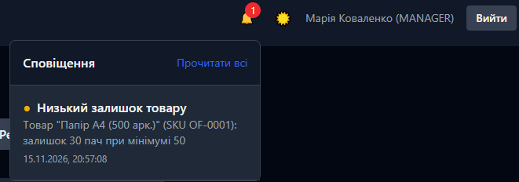
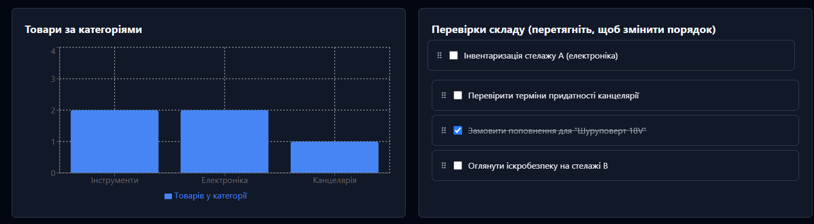
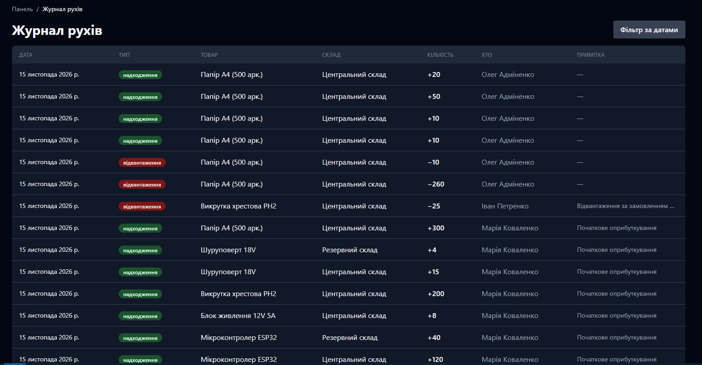
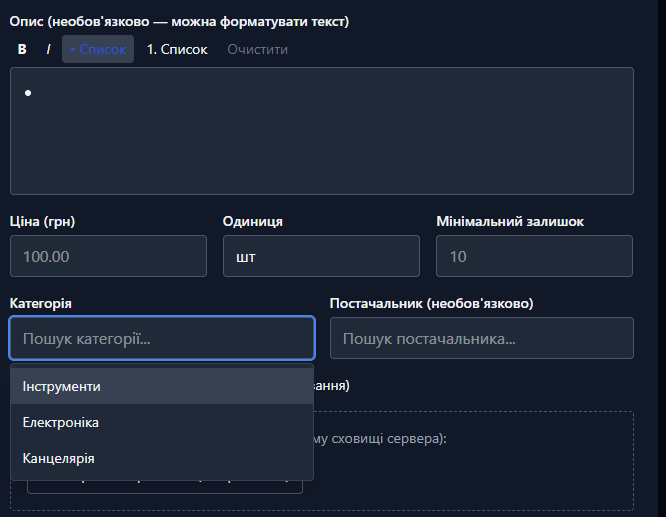
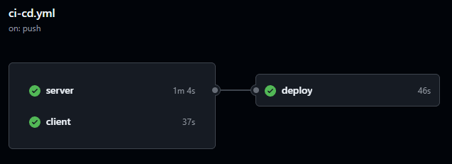

# Звіт з лабораторної роботи №6

**Тема:** Реалізація розширених можливостей та розгортання клієнтської частини  
**Предметна область:** Система обліку інвентарю на складі  
**Виконав:** Шипкін Денис  
**Репозиторій:** https://github.com/Vovchik148/Web.git (клієнт — у теці `client/`)  
**Клієнт (production):** https://web-gamma-bice-43.vercel.app (Vercel)  
**API (production):** https://warehouse-inventory-api-700g.onrender.com (Render + Neon)

## 1. Мета роботи

Здобути практичні навички впровадження функціональності реального часу (real-time), створення розширених UI-компонентів, оптимізації продуктивності та розгортання React-застосунку на хостинг-платформі.

## 2. Що зроблено

| Рівень | Завдання | Реалізація |
|---|---|---|
| 1 | Socket.io-client | `services/socket.ts`: єдиний екземпляр `autoConnect: false`, токен при `connectSocket()`; адреса з `VITE_SOCKET_URL` (без `/api` — інакше це namespace) |
| 1 | Життєвий цикл з'єднання | `useSocketConnection` — викликається один раз у Layout; вхід відкриває з'єднання, вихід закриває |
| 1 | Підписки на події | `useSocketEvent` на `useEffectEvent`: знімається саме власний обробник (`socket.off(event, handler)`) |
| 1 | Сповіщення в реальному часі | `NotificationBell`: подія `notification` з особистої кімнати `user:<id>` → лічильник непрочитаних (Zustand-селектор), історія до 50 записів, toast для HIGH/CRITICAL |
| 1 | Онлайн-статуси | `presenceStore` + `usePresenceSync`: події `presence:list`/`presence:update` → індикатори на сторінці користувачів |
| 1 | Оновлення списків наживо | `useSocketRoom('products')` + події `product:*`/`stock:updated` → `invalidateQueries` — список перезавантажується з сервера |
| 1 | Модальні вікна | Headless UI 2: `Modal` (Dialog + DialogBackdrop + DialogPanel, `transition`, `data-closed:` анімації) на базі нього `ConfirmModal` для всіх CRUD-сторінок |
| 1 | Таби | Headless UI `TabGroup` на детальній сторінці товару: Інформація / Залишки та операції / Історія рухів |
| 1 | Випадне меню з пошуком | Headless UI `Combobox` — вибір категорії та постачальника у формі товару |
| 2 | Drag and Drop | dnd-kit: `TaskBoard` (перевірки складу) — `DndContext` + `SortableContext` + `useSortable`, PointerSensor + KeyboardSensor (доступність з клавіатури), перевірка `over !== null` |
| 2 | Графіки | Recharts 3: `StatsChart` (BarChart, товарові категорії з API) на Dashboard — підключений через `lazy` |
| 2 | Нескінченне прокручування | сторінка «Журнал рухів»: `useInfiniteQuery` + IntersectionObserver на елементі-сторожі |
| 2 | Завантаження зображень з обрізанням | `ImageUploader`: react-easy-crop + обрізання через canvas + upload у файловий сервіс (лаб. 2) |
| 2 | Календар | react-day-picker (mode="range", uk-локаль) — фільтр журналу за датами |
| 2 | Rich text редактор | Tiptap 3: `RichTextEditor` (bold/italic/списки) для опису товару, lazy-завантаження |
| 2 | Анімації переходів | CSS fade-slide за ключем маршруту (`key={pathname}` у Layout), анімовані модальні вікна |
| 3 | Код-спліттінг | усі сторінки через `lazy()` + `Suspense` (fallback — Loading); Recharts і Tiptap — у chunk'ах своїх сторінок |
| 3 | Аналіз пакета | `rollup-plugin-visualizer` (stats.html, у .gitignore) |
| 3 | PWA | `vite-plugin-pwa`: маніфест, service worker (Workbox), іконки (генеруються скриптом `npm run icons`), NetworkFirst-кеш для API (5 хв TTL), офлайн-режим |
| 3 | Кешування запитів | TanStack Query: `staleTime` 30 с, `gcTime` 5 хв — повторні переходи віддаються з кешу |
| 3 | SEO | title/description, Open Graph + twitter:card, `robots.txt`, `sitemap.xml`, `lang="uk"` |
| 3 | Тести компонентів | Vitest + Testing Library: життєвий цикл підписок Socket.io (знімання власного обробника), лічильник сповіщень, діалог підтвердження (Esc/cancel/confirm) |
| 3 | CI/CD | GitHub Actions: server (Postgres+Redis services, міграції, 68 тестів) → client (lint, Vitest, build) → deploy на Vercel через CLI (лише з `main` після успіху) |

## 3. Технології

Socket.io-client, Headless UI 2, dnd-kit, Recharts 3, react-day-picker 10, react-easy-crop, Tiptap 3, vite-plugin-pwa, Vitest + Testing Library, rollup-plugin-visualizer, Vercel + GitHub Actions — поверх стеку лаб. 4-5 (React 19, TypeScript, Vite 8, Tailwind 4, React Router 8, Axios, Zustand, TanStack Query).

## 4. Хід роботи

### 4.1 Socket.io-client і життєвий цикл з'єднання

З'єднання — одне на застосунок: екземпляр створюється поза React (`autoConnect: false`), токен передається лише в момент `connectSocket(token)`, підписуватися на події компоненти можуть будь-коли. Керування — у `useSocketConnection`, який викликається один раз у `Layout`: вхід відкриває з'єднання, вихід закриває. Кожен компонент підписується на події через `useSocketEvent` і знімає **саме свій** обробник у cleanup-функції (`socket.off(event, handler)` за посиланням) — підписки інших компонентів не зачіпаються. Адреса сервера — `VITE_SOCKET_URL` без префікса `/api` (він належить лише REST-маршрутам, інакше Socket.io сприйняв би його як namespace).

Перевірено в Network (фільтр WS): після входу з'являється з'єднання зі статусом 101, після виходу — закривається.

### 4.2 Сповіщення, онлайн-статуси, наживо-списки

**Сповіщення.** `NotificationBell` у шапці підписаний на подію `notification` (особиста кімната `user:<id>` з лаб. 3). Події мапляться на варіанти UI (LOW_STOCK → warning тощо), непрочитані лічаться в Zustand-селекторі — компонент перемальовується лише при зміні числа. Сповіщення з пріоритетом HIGH/CRITICAL дублюються toast-ом. Живий сценарій перевірено наживо: списання товару нижче мінімального залишку через REST → черга BullMQ на сервері → WebSocket → лічильник дзвіночка оновився без перезавантаження сторінки.

**Онлайн-статуси.** `usePresenceSync` підписаний на `presence:list` / `presence:update` — на сторінці користувачів зелений/сірий індикатор біля кожного імені оновлюється в реальному часі.

**Оновлення списків.** `ProductsListPage` приєднується до кімнати `products` (`useSocketRoom`) і на події `product:created|updated|deleted` та `stock:updated` викликає `invalidateQueries({ queryKey: ['products'] })` — TanStack Query перезавантажує дані з сервера, який залишається джерелом істини (без ручного редагування масивів).



— дзвіночок сповіщень з непрочитаним LOW_STOCK і toast про критичний залишок.

### 4.3 Headless UI: модальні вікна, таби, Combobox

`Modal` на Headless UI 2 (Dialog + DialogBackdrop + DialogPanel): портал, focus trap, закриття по Esc і кліку на фон, атрибути доступності — все бере на себе бібліотека; анімація вмикається атрибутом `transition` зі стилями `data-closed:`. На базі Modal зроблено `ConfirmModal`, який використовують усі CRUD-сторінки (заміна window.confirm — доступний з клавіатури і не блокує потік).

Детальна сторінка товару перероблена на **таби** (`TabGroup`): Інформація / Залишки та операції / Історія рухів. У формі товару `<select>` замінені на **Combobox з пошуком** (категорія, постачальник) — інтегровані з React Hook Form через `setValue`.

### 4.4 dnd-kit і Recharts

`TaskBoard` на Dashboard — список перевірок складу з перетягуванням: `DndContext` + `SortableContext` + `useSortable`, `arrayMove` у `onDragEnd` з перевіркою `over !== null` (відпускання поза списком). Два датчики: `PointerSensor` (миша/дотик) і `KeyboardSensor` (Пробіл — взяти, стрілки — перемістити). Порядок зберігається у власному стані — бібліотека лише повідомляє про результат.

`StatsChart` (Recharts BarChart) — товарові категорії з реальними даними API (`productCount`). Компонент підключений через `lazy()` — Recharts потрапляє в chunk Dashboard, а не в початкове завантаження.



— Dashboard: графік категорій (lazy Recharts) і список перевірок з перетягуванням.

### 4.5 Нескінченне прокручування, календар, зображення, редактор

**Журнал рухів** — нова сторінка: `useInfiniteQuery` (ключ містить фільтри) + `IntersectionObserver` на елементі-сторожі в кінці списку → автоматичне довантаження сторінок при скролі. Фільтр за діапазоном дат — **календар** react-day-picker (`mode: 'range'`, uk-локаль), параметри `from`/`to` йдуть у API.

**Зображення** — `ImageUploader`: вибір файлу → попередній перегляд і обрізання react-easy-crop → обрізаний Blob через canvas → upload у файловий сервіс серверної частини (`POST /api/files/upload`).

**Rich text** — Tiptap 3 для опису товару (bold/italic/списки): підключений через `lazy()` (важка бібліотека — окремий chunk), HTML-вихід зберігається в `description`; Tiptap за своєю схемою не пропускає довільні скрипти.



— журнал рухів: нескінченне прокручування, календар-фільтр, типи операцій.



— форма товару: Combobox з пошуком і Tiptap-редактор опису.

### 4.6 Оптимізація продуктивності

**Код-спліттінг**: усі сторінки, крім Home/Login/Register, через `React.lazy()` + `Suspense` (fallback — спінер). Результат у збірці: Recharts (49 кБ chunk Dashboard), Tiptap (129 кБ chunk ProductForm), react-day-picker (85 кБ chunk MovementsPage) — у окремих файлах; початкове завантаження їх не містить. Розміри проаналізовано через `rollup-plugin-visualizer` (stats.html).

**Кешування запитів**: TanStack Query (`staleTime` 30 с, `gcTime` 5 хв) — повторні переходи між сторінками віддають кешовані дані миттєво; після мутацій кеш інвалідується точково за ключами.

**Анімації**: переходи між сторінками (fade-slide за ключем маршруту) і анімовані модальні вікна (Headless UI `transition`).

### 4.7 PWA та SEO

`vite-plugin-pwa` (`registerType: 'autoUpdate'`): маніфест (назва, uk, standalone, іконки 192/512 — згенеровані скриптом `npm run icons` з SVG-логотипа через sharp) та service worker на Workbox: API-запити (`/api/*`) — стратегія **NetworkFirst** з таймаутом 5 с і TTL кешу 5 хвилин (персональні дані не зберігаються надовго — безпека після logout). Перевірено: `npm run build && npm run preview` → DevTools → Application → service worker зареєстрований; у Network → Offline перезавантаження відкриває оболонку застосунку з кешу.

SEO: осмислені `title`/`description`, `lang="uk"`, Open Graph + twitter:card для прев'ю посилань, `robots.txt` (службові сторінки Disallow) і `sitemap.xml` для публічних сторінок.

### 4.8 Тестування компонентів

Vitest + Testing Library (jsdom, mock matchMedia у setup). Ключовий тест — життєвий цикл Socket.io: справжній сокет підмінено емітером, перевірено, що подія `notification` збільшує лічильник, клік позначає прочитаним, а **після розмонтування компонент знімає саме свій обробник** (`socket.off(event, handler)`) — та помилка життєвого циклу, про яку попереджала теорія. Також протестовано діалог підтвердження (confirm / cancel / Escape).

```bash
npm test     # 5 тестів, усі проходять
npm run lint # без помилок
npm run build
```

### 4.9 CI/CD

`.github/workflows/ci-cd.yml`: на кожен push/PR у `main` —

1. **server**: піднімає PostgreSQL і Redis як services, застосовує міграції, збірка, 68 тестів;
2. **client**: лінт, 5 тестів компонентів, збірка з тестовими `VITE_*`;
3. **deploy** (`needs: [server, client]`, лише push у `main`): `vercel pull → build → deploy --prod` через CLI.

Обидві перевірочні jobs мають `timeout-minutes: 10`. У процесі налаштування виправлено два реальні інциденти: (1) BullMQ вимагає `maxRetriesPerRequest: null` — черзі виділено власні Redis-з'єднання замість спільних з кешем (спільне з'єднання з обмеженими ретраями валило ініціалізацію, і задачі йшли через fallback, а worker тримав event loop і висячі тести в CI); (2) lockfile, згенерований npm на Windows, не містив залежностей wasm32-фолбеків інших платформ — перегенеровано в Linux-середовищі (Docker node:24).



— зелений ран CI/CD: server, client, deploy.

### 4.10 Розгортання

Клієнт розгорнуто на **Vercel** (https://web-gamma-bice-43.vercel.app), сервер — на Render з базою Neon (лаб. 3). Особливості, які довелося врахувати:

- `VITE_*` змінні підставляються **під час збірки**: задані в налаштуваннях проєкту Vercel (`VITE_API_URL`, `VITE_SOCKET_URL`);
- **Root Directory**: під час деплою через CLI налаштування Root Directory = `client` давало подвійний шлях (`client/client`) — у проєкті Vercel поле очищено, бо робочий каталог workflow вже `client`;
- **SPA rewrite** у `vercel.json` — прямі адреси `/products/51` віддають `index.html`;
- після першого деплою адресу клієнта вписано в `FRONTEND_URL` на сервері (CORS + Socket.io).

Фінальна перевірка production: логін з засіяної Neon-бази, каталог, CRUD, дзвіночок реального часу, PWA service worker, офлайн-режим.

## 5. Висновки

Завершено повноцінний full-stack застосунок: клієнтську частину доповнено обміном даними в реальному часі (Socket.io з коректним життєвим циклом з'єднання — одне з'єднання на застосунок, точкове знімання обробників, відновлення даних через invalidateQueries замість ручного стану), розширеним набором інтерактивних компонентів (Headless UI — модальні вікна, таби, Combobox; dnd-kit з клавіатурною доступністю; Recharts; нескінченне прокручування; календар; обрізання зображень; Tiptap), оптимізацією продуктивності (код-спліттінг за маршрутами і бібліотеками, PWA з офлайн-режимом, кешування запитів) та SEO. Систему накрито CI/CD-конвеєром GitHub Actions (тести обох частин проти реальних сервісів → деплой на Vercel після зелених перевірок) і розгорнуто у робочому середовищі (Vercel + Render + Neon). У процесі виправлено реальні інфраструктурні проблеми (несумісність BullMQ з обмеженими ретраями ioredis, платформозалежний lockfile npm), що дало практичне розуміння тонкощів робочого середовища за межами локальної розробки.

## 6. Матеріали проєкту

- [docs/WEBSOCKET_API.md](../docs/WEBSOCKET_API.md) — WebSocket API серверної частини
- [docs/DEPLOYMENT.md](../docs/DEPLOYMENT.md) — розгортання серверної частини (Render)
- [client/README.md](../client/README.md) — клієнтська частина: запуск, структура, розгортання
- Кореневий README — фінальний опис full-stack проєкту з посиланнями на production
